# Haze version history

What each release added, newest first. Every release's notes, downloads and validation are on the [releases page](https://github.com/gazhenko/haze/releases).

## 1.1.3: one held evening, and a faster bath hall

Morrow stays in its held evening until the end of Act VIII: a finished round stops the rain over its district and leaves a lit, local change there, and morning comes only over Elias's rowboat. The cove entrance to the Baths no longer jumps in light or fog. The bath hall draws fewer shadows and runs faster.

## 1.1.2: the crossing, the landing and the Baths' evening

Fixes from a playthrough. The sea stays out of the rowing boat. Reaching the jetty fades to black and back. The cliff stair is two metres wide and clear of the rock. The gate across the bath hall is gone. The Baths stay in the held evening after the last valve, so the walk down to the village no longer jumps from morning to night.

## 1.1.1: letters, echoes and credits that agree

A continuity and wording pass. The letters agree with one another and with what the pools show. Nine echo lines are retimed and re-voiced. The seed tins, the schoolhouse clock and the chalk lines match their pages. The credits name R. Pask and the source of the founder's portrait.

## 1.1.0: puzzles to work out, a second ending, and new people

Letters and notices no longer state the next step, and wrong settings describe what you see rather than name the fault. The bell song is reversed at the winches, and at the Heart it gains a sixth note you must find. The early acts keep their secrets for the Heart to reveal. Keeping the Guest's gift is now a true ending. The echoes wear period clothes and hold real gestures. The epilogue is seen from behind the bench under Mara's night-flowering tree. Night exteriors are lighter, and each correspondent writes in their own hand.

## 1.0.5: wires that stay drawn at a distance

The wire between the summit's poles is drawn no thinner than about a pixel and a half across, however far off, so it reads as a fine dark line against the sky; drawn at its own width, it had thinned into faint, broken dashes towards the far poles. The village's clothes lines are drawn the same way.

## 1.0.4: the landing cove's boulders and jetty

The boulders round the landing below the Baths weather to a grey a few shades paler than the cliffs they came from; in the morning sun they had stood on the green slopes nearly black. The joints between the jetty's setts are packed with grit nearly to the top, where they had lain deep in dark soil, so the lines between the stones are lighter.

## 1.0.3: dark windows on the Cure's shut storeys

Coming up the drive in the fog, the few open windows of the Cure's closed upper floors had stood out pale, lighter than the wall round them, as if lit. Their glass is now dark below the drawn blinds, as an empty room's would be.

## 1.0.2: even hair on the figures of light, and no glare in the ending

The remembered islanders' hair glows as one soft mass, as their faces do; it had shown dark blocks among bright strands. In the ending's first view a low sun no longer lies on the wet sand at your feet as a blown-out white disc: the drained floor keeps its mirror sheen of the sky, with only a soft brightening toward the sun.

## 1.0.1: a subtitles switch and brighter rooms

Settings and the pause menu have a Subtitles switch beside Sound, kept between visits. The lamplit rooms are brighter once your eyes have adjusted, so the archive, the mill and the pump house read; the Heart keeps its light as it was. With a controller, up and down now move to the next row and left and right along it, so down from Sound no longer skips to Back.

## 1.0.0: the finished game

A pause now holds the island: its clock, its figures and its sounds wait while the score and the menus carry on. Long pages read further down with the right stick or the arrow keys, as with the mouse wheel. Voices have their own volume, and mute is kept between visits. The tower's four dials on the summit are lit through the evening and put out by morning, the Heart's floor and levers are remade, and the bench in the epilogue has cast-iron ends. The landing turns to morning once the visit is over. The credits name the game's sources and can be passed over once they have begun. Counts, times and names agree between the pages, the voices and the rooms.

## 0.30.0: rain that stops at the roofs, lamps and lit windows by morning

The rain round the visitor ends at the first thing it would hit, so the rooms seen from their doorways are dry while the street's rain still falls beyond them. Lit windows show their rooms in daylight by morning, and the street lamps and lanterns ease out with the sky as you walk from one district's evening into the next. The Cure's lobby has its gas brackets lit, and the lighthouse lamp room's glazing is clear of the bright discs it had shown.

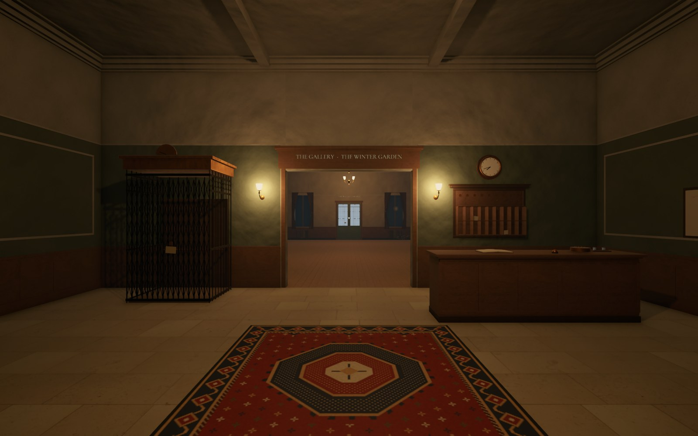

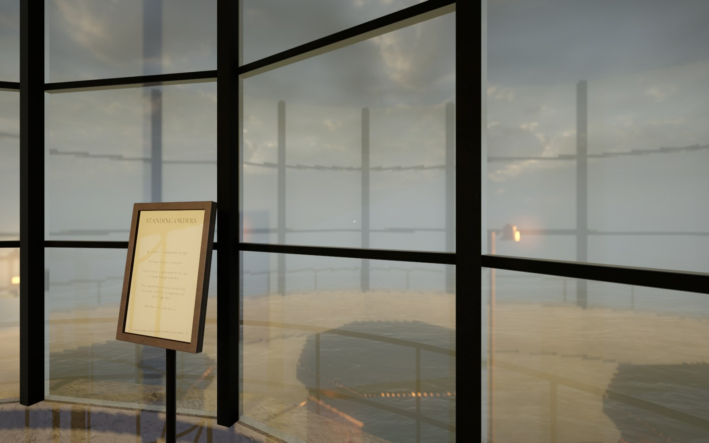

## 0.29.0: the rain sky in the Linux build, the west cliffs' inlet and sea cave

In the Linux build the storm cloud is whole again; it had broken into straight-edged slabs across the sky in the rain. Under the west headland the inlet's mouth has a shoreline of its own, the sea cave's floor runs out under the shingle instead of ending in a slab edge, and the inlet's south wall carries the cliff face's bedded rock round the corner. The casting hall and winch house are slated, the working buildings are bare stone and brick inside, and the figures of light show the folds of their clothes.

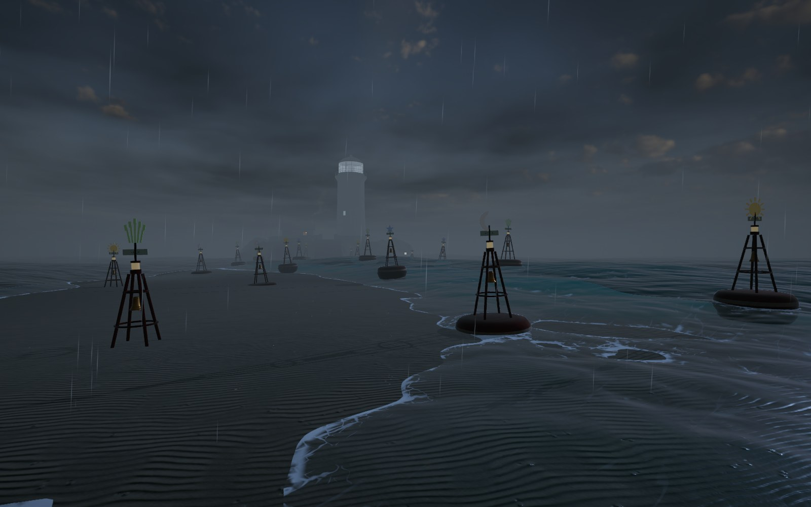

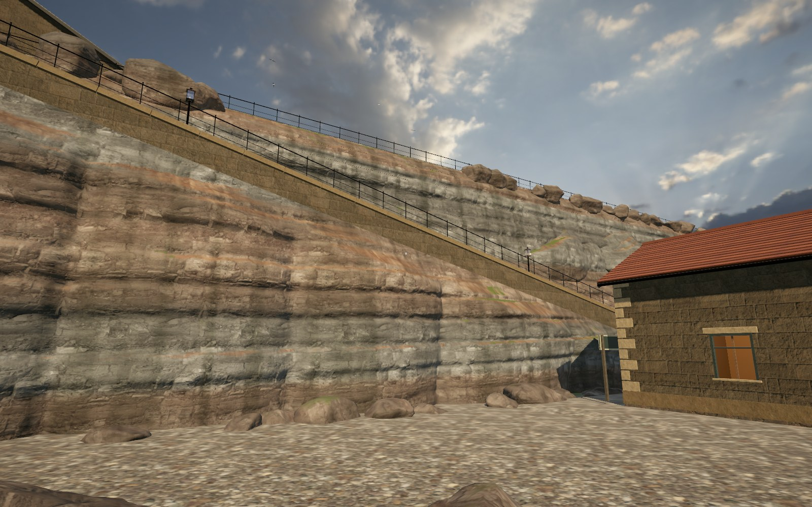

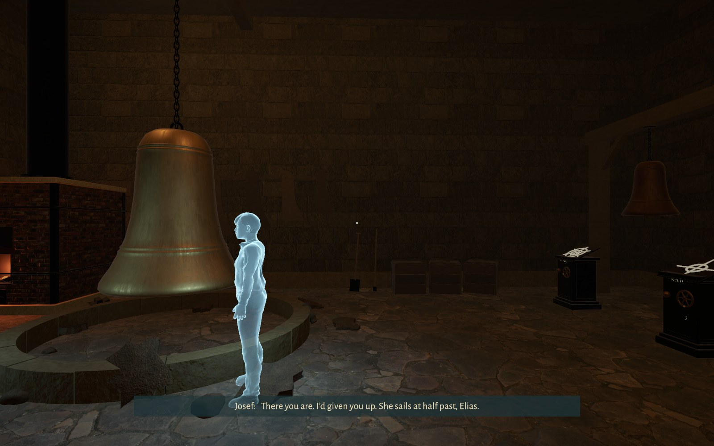

## 0.28.0: gulls in the Linux build, the tide mill's gates

In the Linux build the gulls that rise when the rain stops are birds again; they had been drawn as bright blots that bloomed across the morning sky and over the closing credits, and on the Mac they had been flat black silhouettes. At the tide mill the sea gate rides in iron guides between capped stone piers, wound up by a toothed rack and a pinion in a cast headgear on its headstock, and the pond and race gates hang in braced frames with lifting rods.

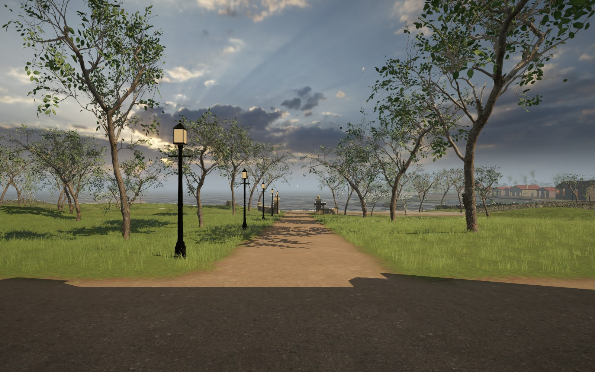

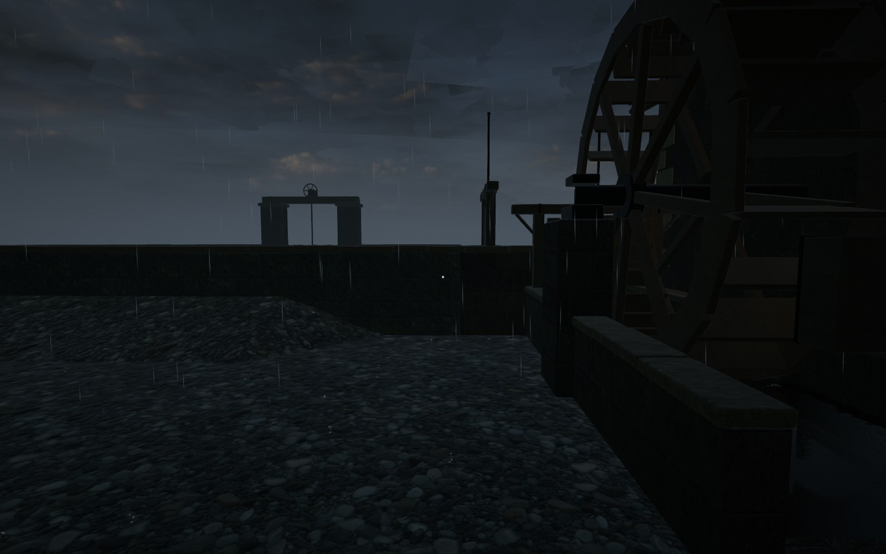

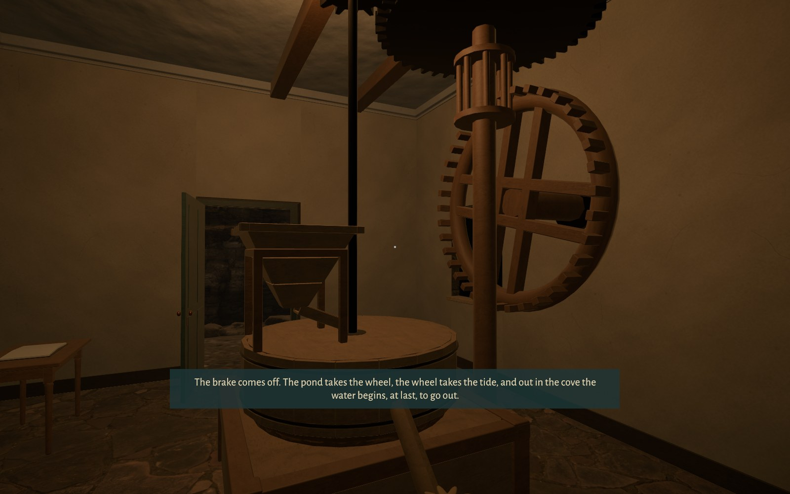

## 0.27.0: lamplight on the wet street, two storeys, the night-flowering tree

At night in the rain each street lamp is drawn out across the wet setts in a long, broken streak toward you, glinting off the crown of every stone. The village's lit windows glow through net curtains, two of its houses stand two storeys high, the night-flowering tree on the mainland hill is broad and gnarled over the bench, and the woods at the Springs and on the summit are the countryside's dense-crowned, wind-shaped trees. The west cliffs are weathered grey down to a tide line of wet shingle, and the sea caves' mouth opens cleanly in the rock. In the Cure each room is lit by its gasolier, bright beneath it and falling away into the corners. In the Light's lamp room the great lens is clear prismatic glass and the flame glints in the glazing instead of flaring across it, and the rooms everywhere have smooth painted plaster walls and hanging paraffin lamps.

The sea caves' chambers are hollowed and scalloped by the sea, people's faces carry their creases, field gateways hang five-bar gates between stone posts, the camera obscura's picture fills its table to the frame, and the foundry yard has sheerlegs over a new bell. The keepers' boathouse has its slip, and the Springs pump house its beam engine on cast plummer blocks. On an M1 Pro a frame in the village street takes 17 ms where it had taken 27. The release notes list more than two hundred changes.

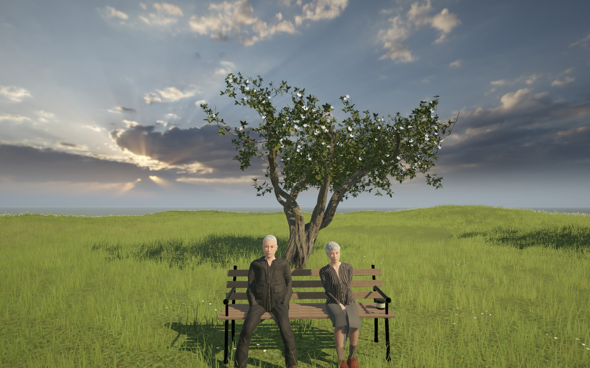

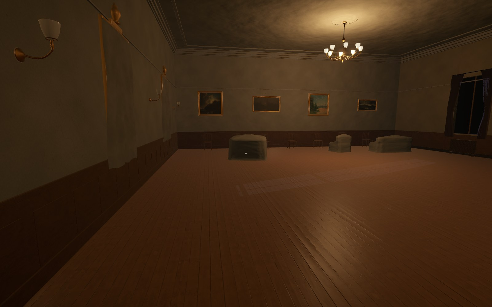

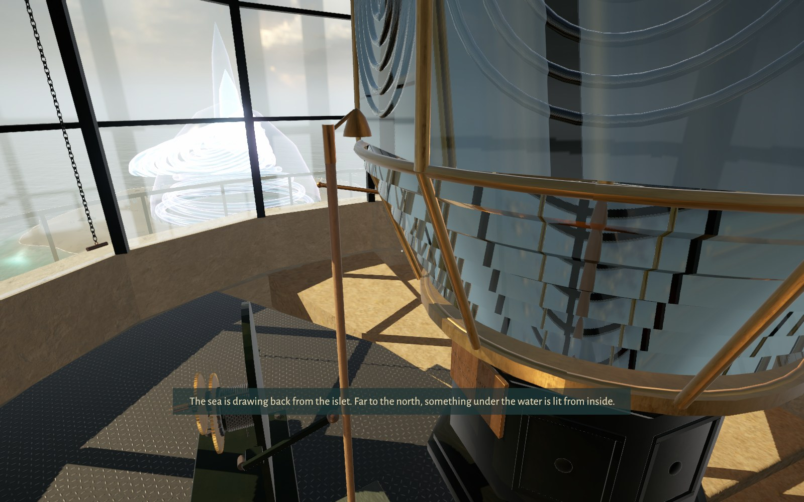

## 0.26.0: woods, fields, walls and the Springs' stream

The countryside has woods: wind-shaped trees with dense crowns and gnarled trunks stand close, with younger ones growing up between them, where one thin-crowned oak had stood alone every 8 m like an orchard. Each walled field is put to a use: pasture grazed short and green, hay standing in flower, aftermath pale where it has been mown, rough grazing. You can see the use in its turf and in how thick and tall its grass grows. The grass blades are as fine as a meadow's, and past where they are drawn the turf keeps a field's grain. The field walls are laid in grey split stone instead of stacked yellow-green cushions, boulders and crags are broken blocks with sharp arrises, and the west cliffs are streaked and bedded in greyer stone above a cove shaped by the sea. At the Springs, opening the outflow lifts the sluice gate on its rack and pinion. The warm water runs under the road through a culvert, out under a ring of voussoirs between wing walls into a shingle bed of its own, riffling over dark wet stones, and away behind an iron grating. The warm spring lies sunk in its hollow, ringed by clusters of crystal, and the summit heliograph has a round mirror on trunnions.

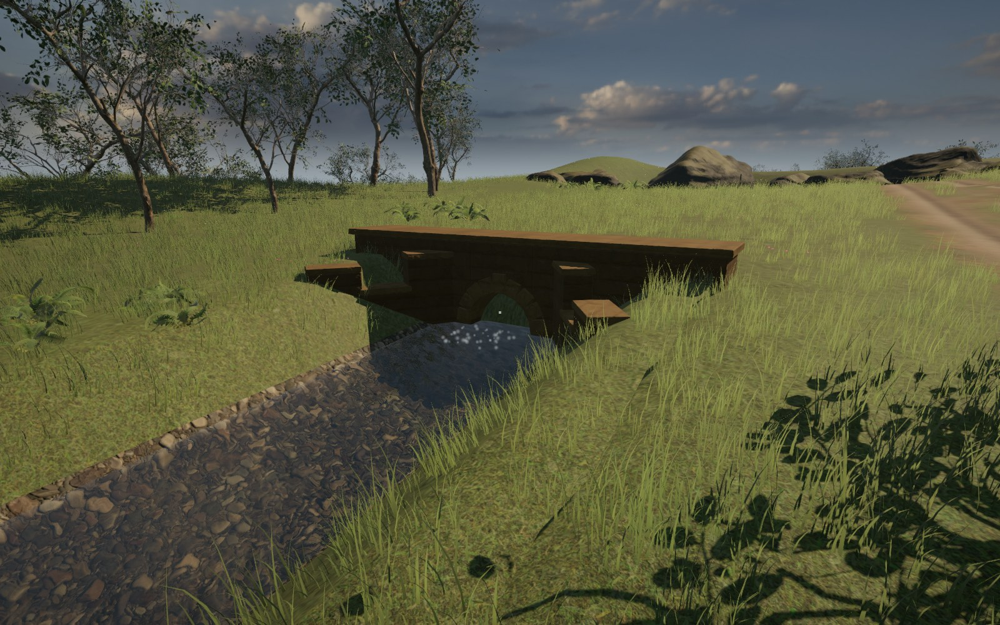

## 0.25.0: shingle shores, signs you can read, rooms furnished

The island's beaches are shingle: rounded pebbles at their real size on the upper shore, damp sand where the sea washes; the coves below the Light and the Baths keep their pale sand. Signs, plates and labels are painted lettering that can be seen from across the street, on both faces of a roadside board. The island's guest book, daybooks, register and logs lie open in their keepers' hands; its shelves face the room, stocked with bottles and bell patterns; the telegraph room has its wiring and battery, the foundry yard its clutter, the boathouse its studs; the Winter Garden's aisle is laid in octagon tiles behind a glazed pair of doors; the Cure's hydrotherapy hall is tiled and screened into bath bays, the schoolroom has its slates, stove and blackboard, and the Cure's gate its piers and open iron gates; the camera obscura throws the live island onto its table, the master clock has a turret movement of brass wheels and its tower a copper spire; the harbour quay has its bollards, creels and fish boxes and the street its water butts and benches, the lighthouse its railed gallery and the sea caves open in the cliff's own rock; the west cliffs are bedded rock rather than a flat wall, the field walls are laid dry in courses, and the coast goes in and out; on the last morning the letter goes from hand to hand under a tree in flower, with Morrow clear on the horizon; and inside the Company archive's cabinet the remembrances are filed in bundles tied with red tape. The bathhouse basin holds its deep green water again instead of turf, and the lighthouse throws soft shafts of light instead of hard white discs.

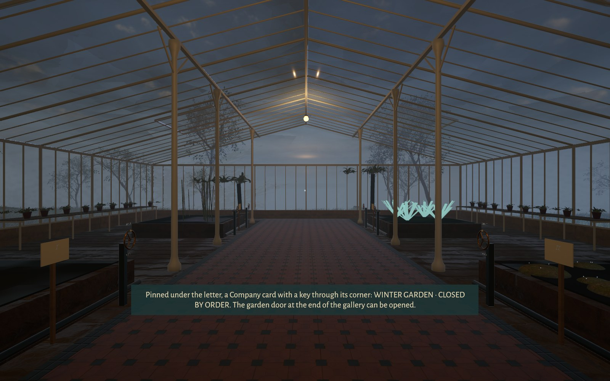

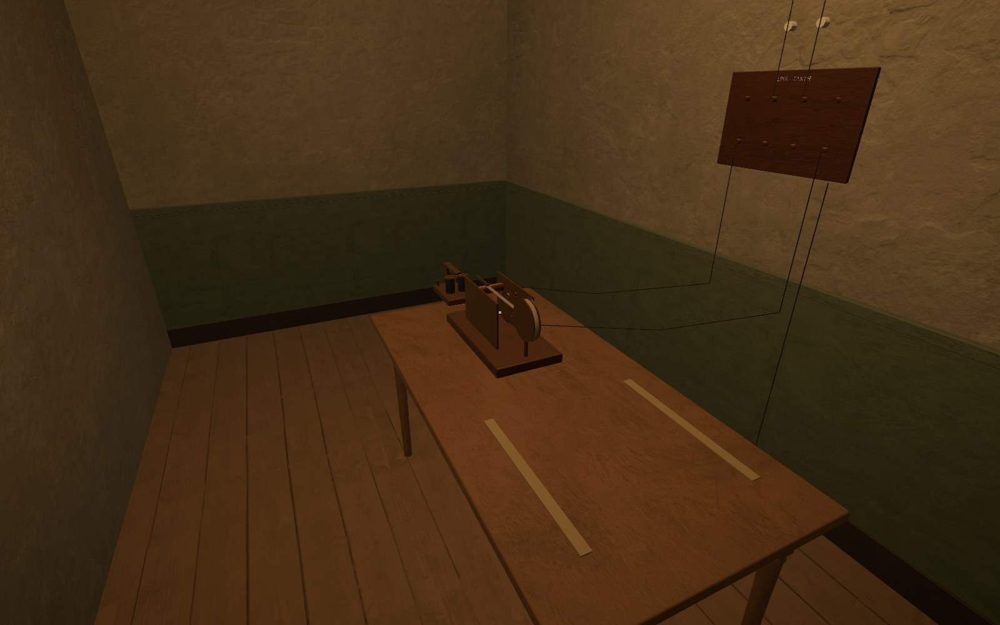

## 0.24.0: the Cure's paintings, ceilings and gasoliers, and its founder

The Cure's picture gallery and ballroom are hung with fifteen real oils of the house's time: seascapes, harbours, the coast and the country, and two portraits. The Metropolitan Museum of Art photographed them and released them into the public domain. Each hangs in a moulded gilt frame of its own proportions. Over the lobby hangs the founder, Horace Lethbridge, painted in 1884 at a window over the sea with a glass of the water held up to the light; his bust in the gallery is carved from the same sitter. Every room hangs a brass gasolier from a moulded rose, its arms sweeping up to opal tulips round the flames. A stepped plaster cornice runs round every room under ceilings laid out in ribs, with deep beams in the lobby. A mahogany long-case clock stands by the hydrotherapy door. The last morning's beach below Ardmouth is shingle, with a path worn up the hill through the turf. The island's people are now lit from the side the light falls on; before, their faces and clothes were lit inside out.

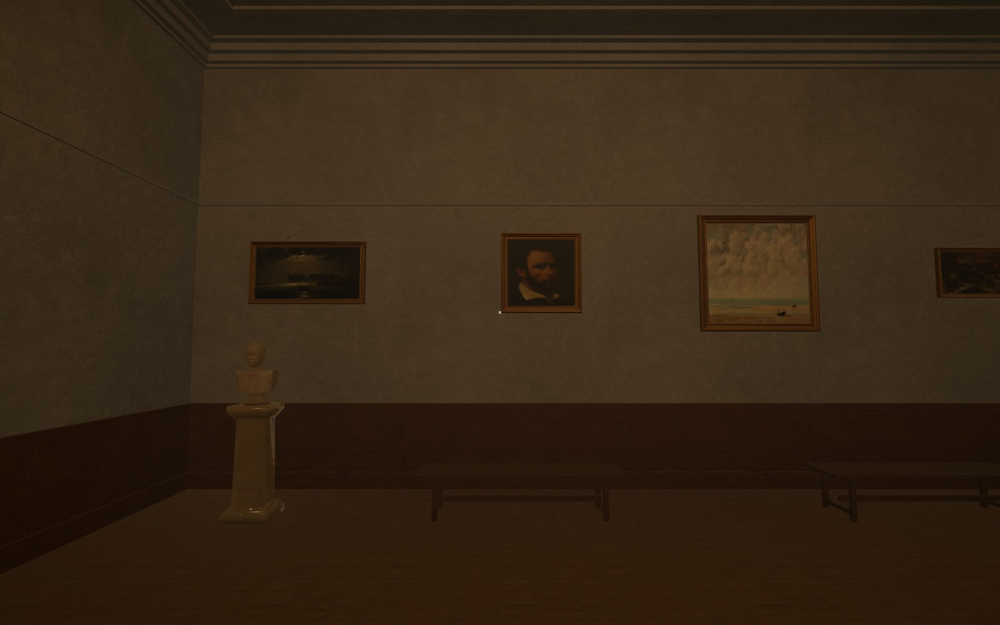

## 0.23.0: granite streets, country lanes and the Cure's rooms

The village street and its seafront are laid in photographed granite setts, worn and uneven, with a course of dressed copings along the sea wall; in the rain they darken and shine like stone. Inside the Cure the rooms reflect their own walls and lit windows instead of the night sky, and a lamp's glow stops at the walls. The haze that hung through its rooms is gone. The orchestrion is a carved walnut cabinet with gilt display pipes, and the founder's bust in the gallery is carved in honed marble from a sitter.

This release also brings the work done for 0.22, which was not released on its own. The roads between the districts are country lanes worn into the ground: packed earth with two wheel ruts and grass up the crown, the verges ragged into the turf, and water standing in the ruts after rain. The field walls are dry stone, laid in worn, uneven stones; they climb the hills and close round their fields. The sea floor shelves in banks and channels, so the shallows no longer end in straight lines, and the Cure and the Springs meet the sea in the same beach as the land round them. The cove below the Baths rises in ledges of dark rock, with fallen blocks heaped at its feet. The village lane runs on up to the summit, whose top is now a worn, lobed table. The rain falls in fine streaks lit by the sky, not long white lines, the village street shines wet under its lamps, and the oaks each grow their own shape.

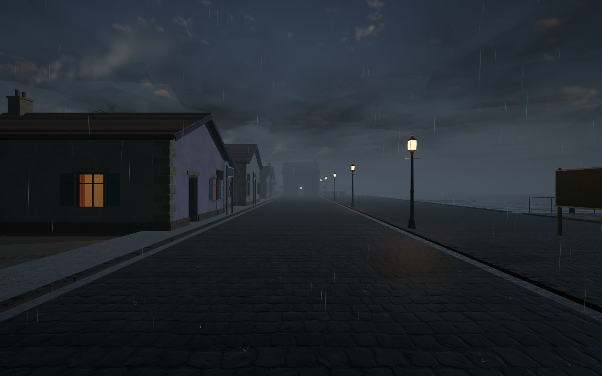

## 0.21.0: the island's seams mended

The places where the one island still showed its seams are mended. The West Cliffs' south wall runs out past the sea caves and crumbles into the sea instead of ending in a straight line, and the sea floor round them shelves out of sight. Beyond the causeway's sandbank the Light's shallows are the island's own, so they no longer read as a sunken rectangle from the summit. The Springs valley is meadow, with leaf litter in patches under woods half as thick again. Boulders and field stones sit bedded in the turf, and meadow grass grows into new country, nearest first, without a hitch.

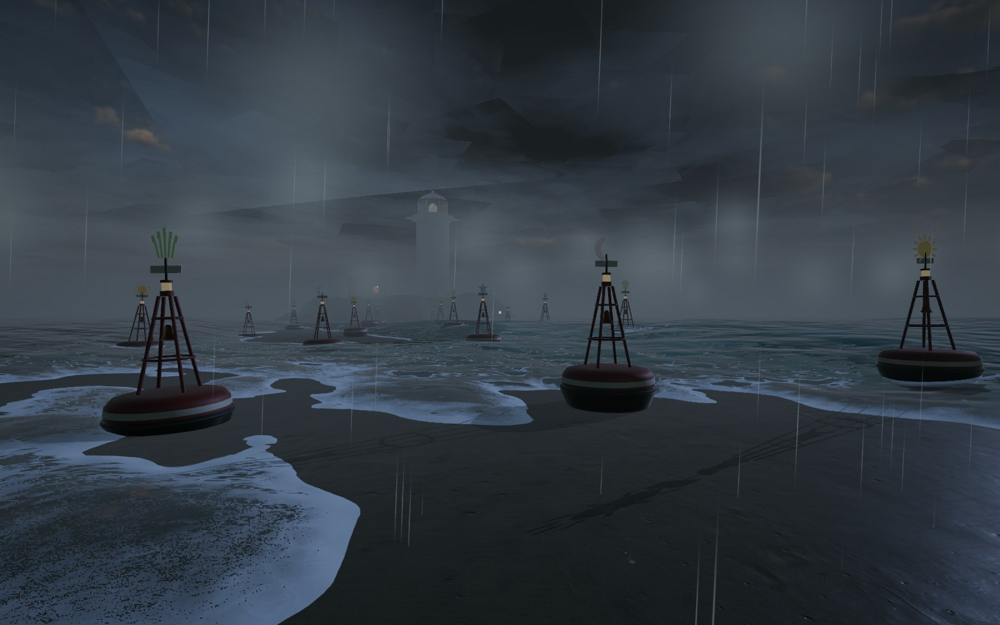

## 0.20.0: one island

Morrow is one island now. Every place stands where it lies, and you walk from one to the next with no fade and no loading: from the boat in the cove up the cliff stair into the bathhouse, out of its north gate and down the headland road to the village, and on by the woods road, the Cure drive and the summit road to every district, with rolling country, dry-stone field walls, copses and meadow grass between them and one sea around them all. Only the voyage to the mainland is still a voyage. Where a place is not yet open to you, the haze stands thick at its border. This release also carries 0.19's work: wood that is wood-coloured, every lamp held by something, the Cure furnished and shut, granite setts in the village street, and the post office.

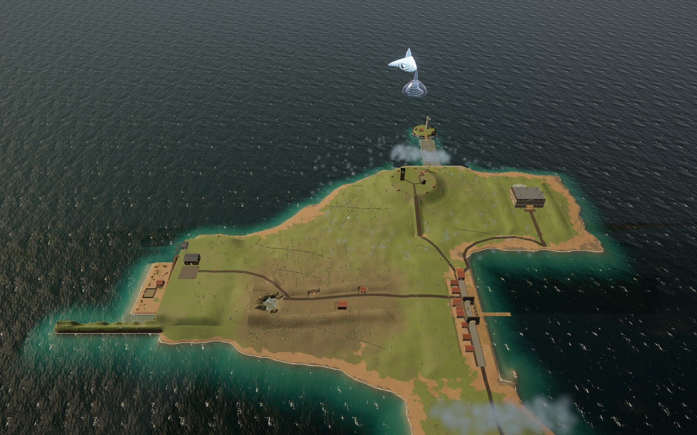

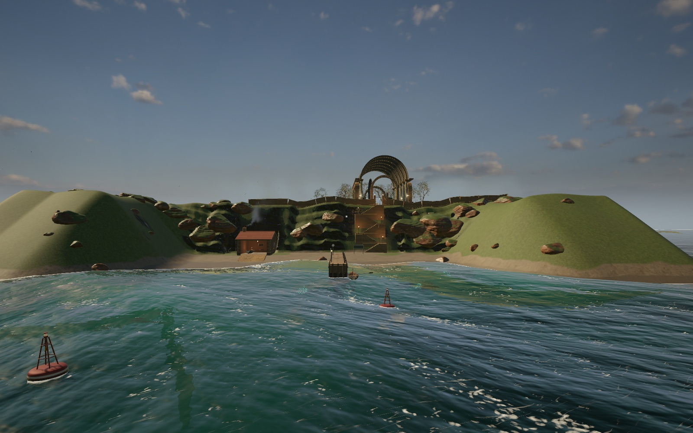

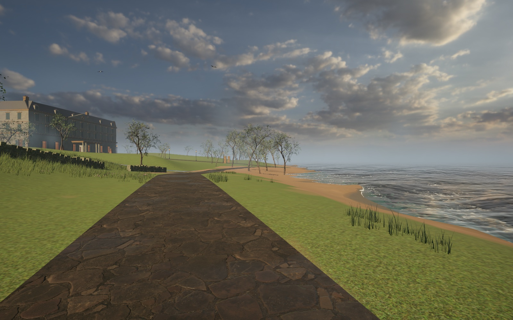

## 0.18.0: white walls, the Cure restored, machines that work

The island's walls are pale lime render at last (they had been drawn in dark concrete under every colour), and the village houses each have their own limewash. The Cure stands as a grand hotel again, closed storeys, mansard and all, with plastered rooms, a cage lift and a palm-house winter garden. Stand-in boxes have become crab winches, a Cornish beam engine, a foundry furnace and a first-order lighthouse lens; skirts come down to mid-calf, and the finale's Guest reads as glass.

## 0.17.0: a finished picture, painted iron, period street lamps

Tone mapping, bloom and colour grading now actually run, with a neutral photographic response, and your eyes adjust as you come in out of the night. Iron is old painted cast iron, the street lamps are glazed cast-iron lanterns that go out at morning, the causeway buoys carry their bells' daymarks, and the Cure's rooms have their oak dados, rails and radiators.

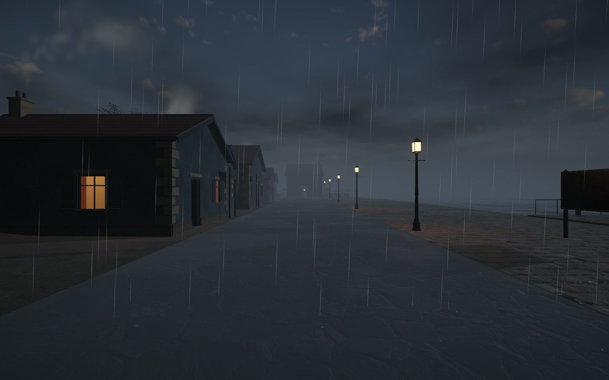

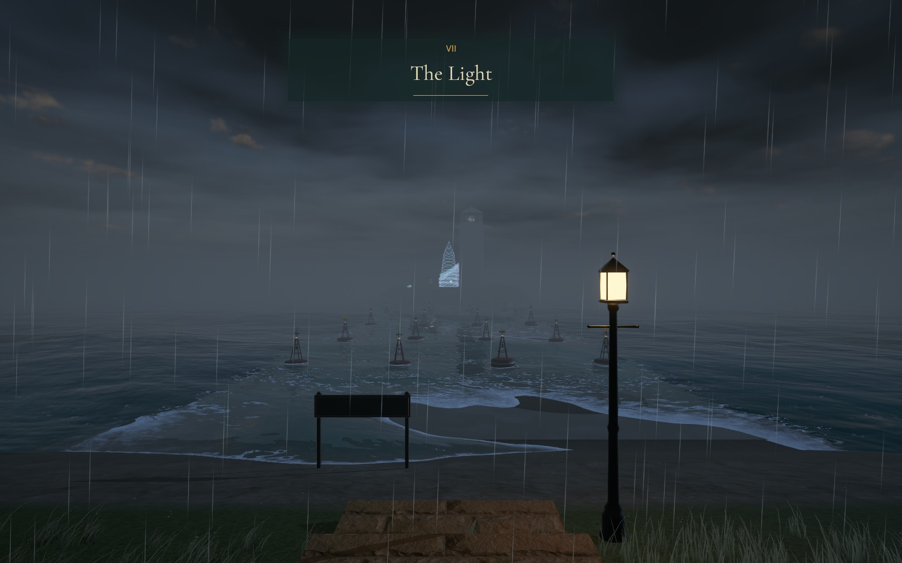

## 0.16.0: lit windows, chimney smoke, rain on the sea

From the street, a lit house's windows show the room behind them in depth as you pass: lamplight on the walls and the house's curtains drawn back at the edges of the glass. Lit houses have their fires going, with a plume of coal smoke leaning away downwind, and the downpour roughens the sea into a dull sheen.

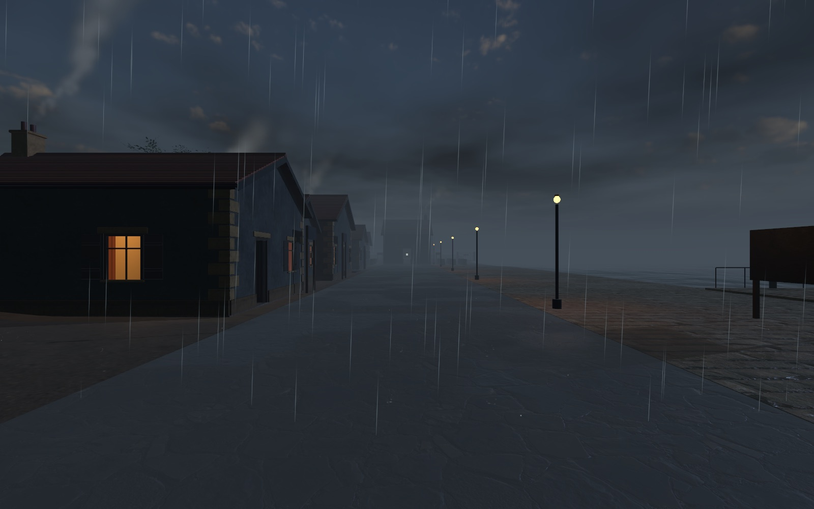

## 0.15.0: houses that are lived in

From inside a lit room the windows now show the night beyond the glass, between a pair of pleated curtains drawn back on a pole. House doors stand open on their hinges, panelled, with brass knobs. Cottage rooms have waxed floorboards and matchboard walls to a dado rail, and the corner stones no longer show through the walls indoors.

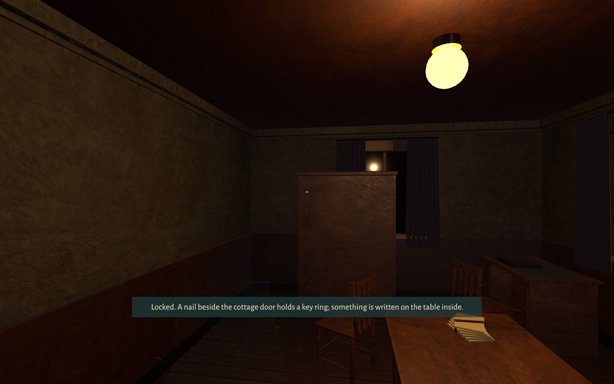

## 0.14.0: meadows in flower, furnished rooms

The island's turf is green grass now, with sun-dried swathes, and much fuller than before. Buttercups, daisies and red clover grow through it in drifts, with sea pinks along the shore. Rooms are furnished properly: turned-leg tables, slatted chairs, pedestal desks with brass pulls, chapel pews and a dressed altar, a panelled bar, skirting boards and cornices. Edges are softly rounded so they catch the light. In the rain, the trees no longer pick up the wet-ground sheen of whatever lies behind them.

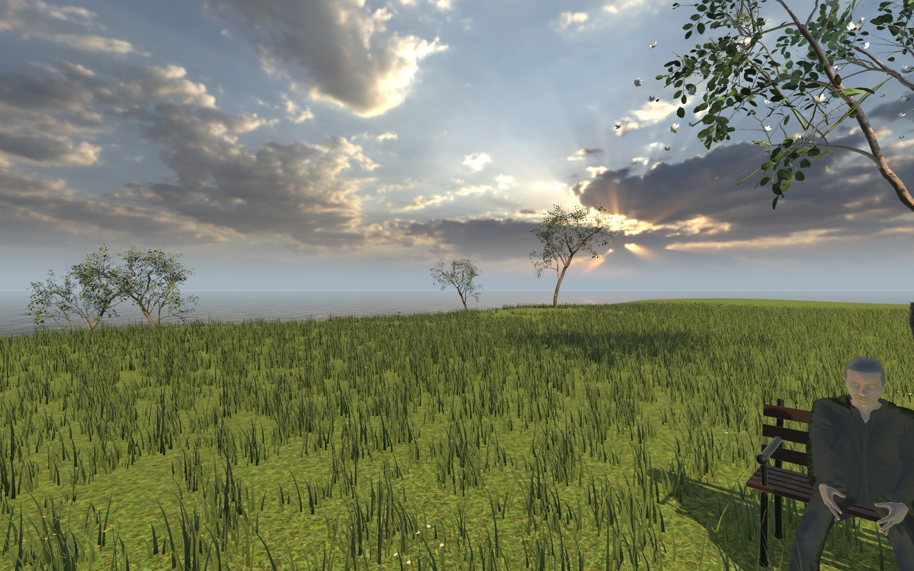

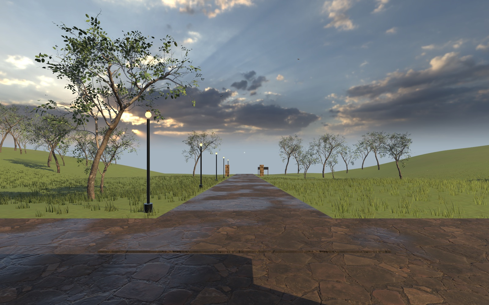

## 0.13.0: morning life and lamp shadows

When a region's round is done and the rain stops, gulls rise over the sea and the cliffs, gliding in slow circles and banking into the turns. At night the lamps nearest you throw real shadows of posts, rails, people and leaves across the wet ground: up to two lamps on the Steam Deck preset and Medium, four on High and six on Ultra.

## 0.12.0: rain on the ground

At night, wet streets, paths and quays reflect what stands above them: lit windows, street lamps, people and the evening sky. The reflections are nearly mirrors in the puddles and a dull sheen on wet stone and earth, broken by the falling rain, and ground under a roof stays dry. Remembered figures now move their heads and hands with their own voices as they speak.

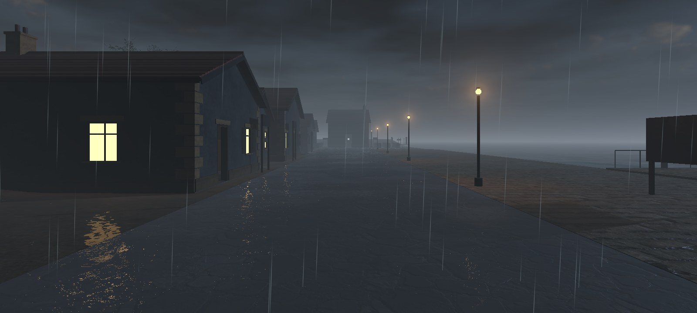

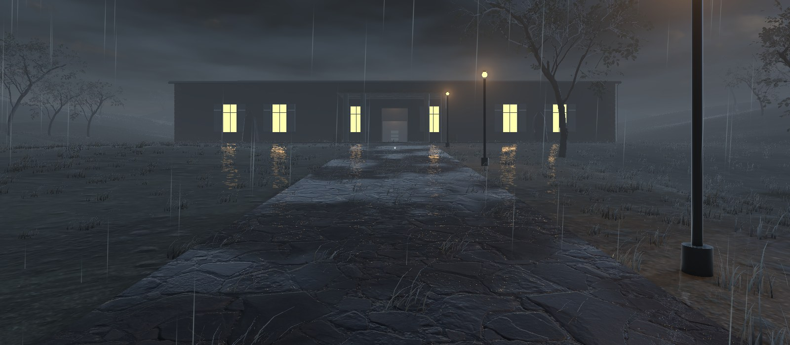

## 0.11.0: Morrow's people

Everyone Morrow remembers is now a real person: Elias, Josef, Mara, Ruth, Ada, Harold and the islanders. Each has a shaped body, a face and hands, hair, and 1956 dress (wool suits, overalls, blouses and skirts), built from MakeHuman's CC0 models. As figures of light they keep their faces, hair and the cut of their clothes. The grown glass is now quartz: six-sided prisms that bend the light behind them into colour. The buildings gained corner stones, shutters, gutters and downpipes. The Steam Deck preset was tuned on a Deck: sharper, fuller, and holding 60 fps in the heaviest scenes, capped at 45 fps on the OLED model and 40 on the LCD model.

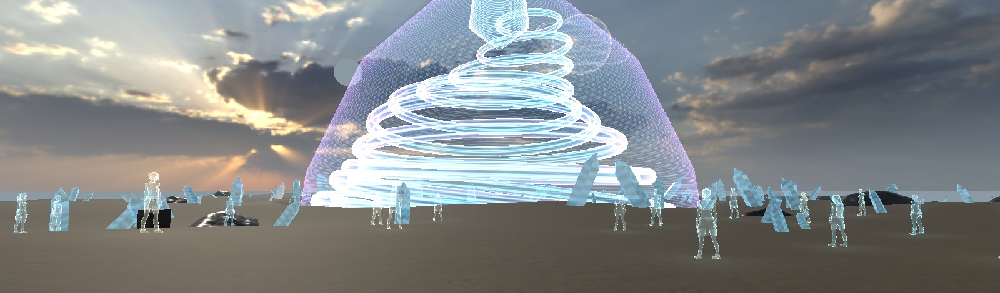

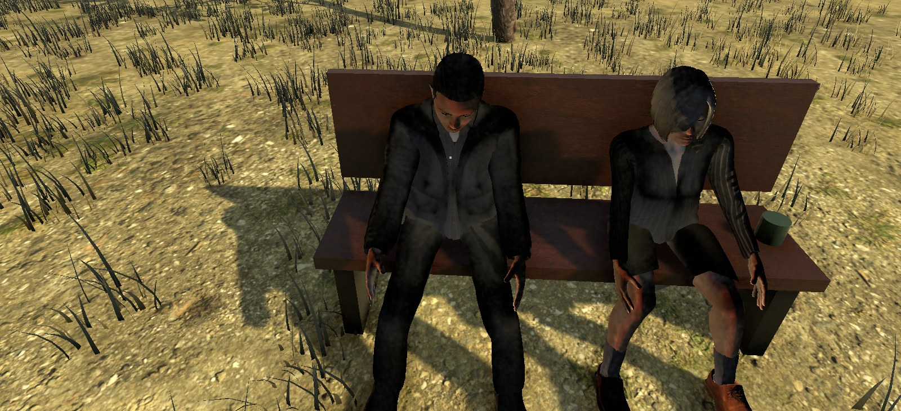

## 0.10.0: sea, weather and the Steam Deck

The crossing is rowed on a real sea. A long swell rolls the boat and the bell buoys, and the wind chop on top of it is simulated on the graphics card every frame, breaking white where the waves fold. You sit in a lapstrake rowing boat with a storm lantern burning behind its glass. Morrow rises out of the haze, and the cove waits at half-flood under a strata cliff, with a dressed-stone quay, cast-iron bollards and a ladder down to the boats.

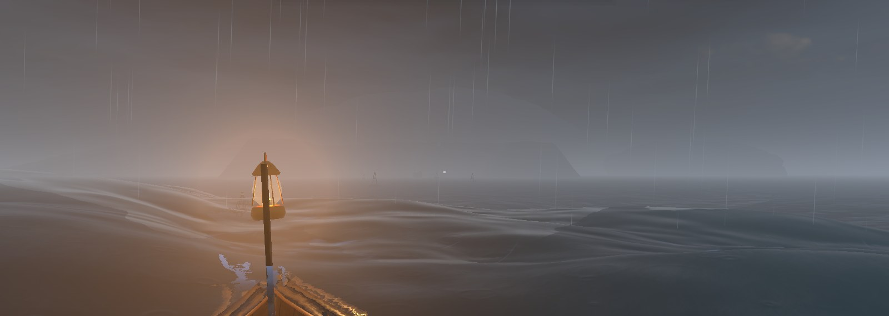

Storm cloud breaks toward evening. Sea mist lies on the water, and lamps glow in the rain. Ground, rock and grass darken in the wet but stay dry under roofs, and rain splashes where it lands. Every boulder is fractured stone with moss on its upper faces. Meadows have grass that moves in the wind. The buildings have proper pitched roofs, window and door frames, lintels and chimneys.

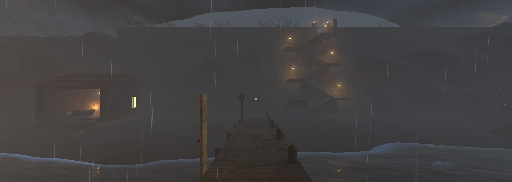

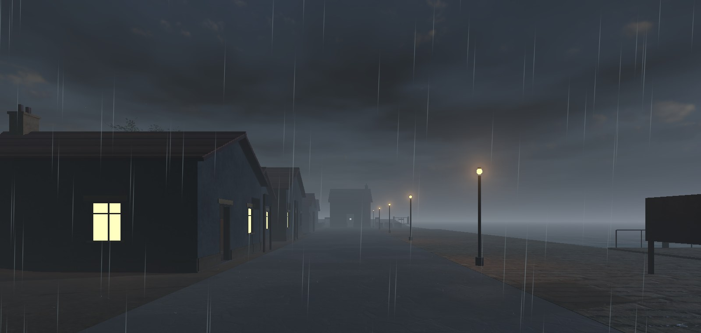

Graphics settings run from **Steam Deck** through Low, Medium, High and Ultra to **Cinematic**, or you can set any of 25 options yourself; the game picks a preset for your hardware the first time it starts. On a Steam Deck, add the Linux build's `play.sh` to Steam as a non-Steam game. The controls work in Game Mode, and with the Deck's own controller when Steam is not running.

## The bathhouse, 0.3 to 0.4

Before the island, Haze was the bathhouse alone: what is now Act I.

### Trailer (the bathhouse, 0.4.0)

[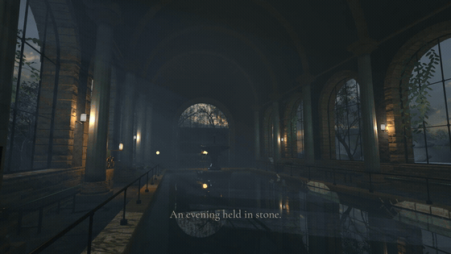](https://github.com/gazhenko/haze/releases/download/v0.4.0/Haze-v0.4.0-Trailer.mp4)

[Watch or download the full 42-second trailer](https://github.com/gazhenko/haze/releases/download/v0.4.0/Haze-v0.4.0-Trailer.mp4) · 1080p · sound on

### Story, sound and music

Haze 0.4.0 gives the house one story. The keeper’s letters, the gardener’s slate, the drowned score, the seal, the journal and the ending now agree about what happened on the evening the house still keeps, and why finishing the keeper’s rounds lets it end.

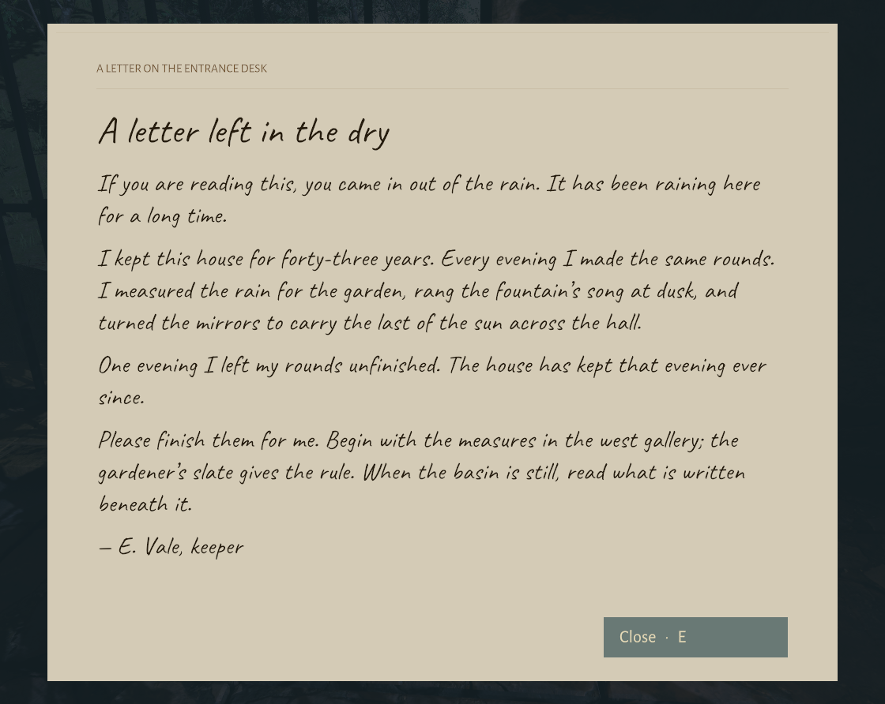

An original score for piano, harp and strings answers each finished round and steps back whenever the bells must be heard. Rain falls on the vault until the light comes home; the sea, wind, water and the brass and stone mechanisms are heard where they are. The interface is quieter: no permanent labels, act titles that appear once, pages in paper, chalk and bronze, and separate volume and music settings.

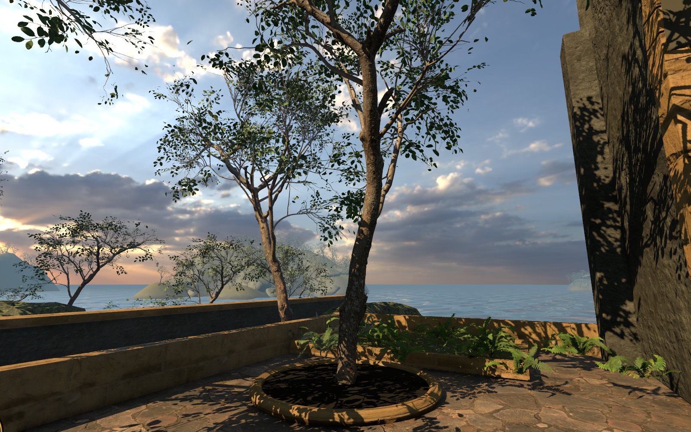

### Lamps and keeper papers

Haze 0.3.2 fitted the small lights with fluted opal glass, brass seats, curved support arms and slotted fasteners. The keeper’s letters carry their full handwritten text on thin folded paper, sealed with poured wax; in 0.4.0 the paper prints the new letters word for word.

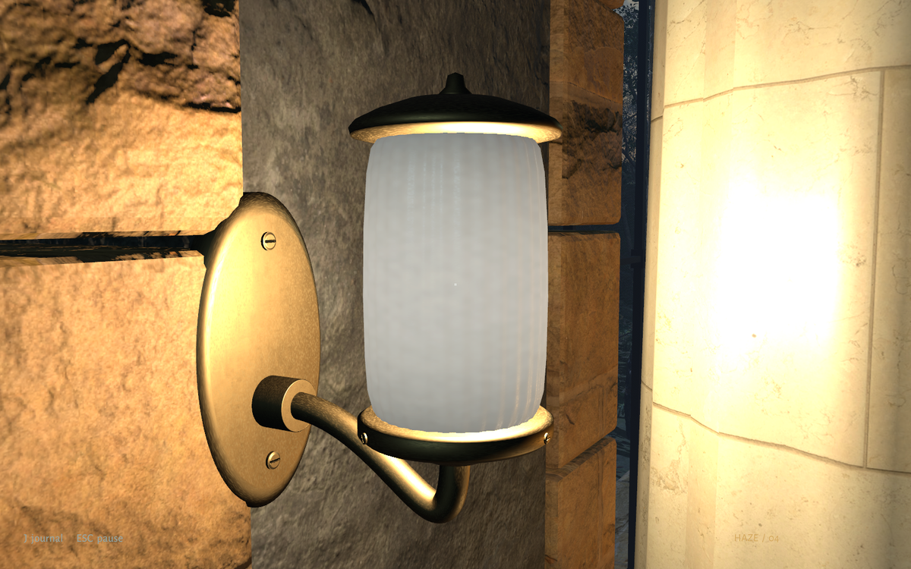

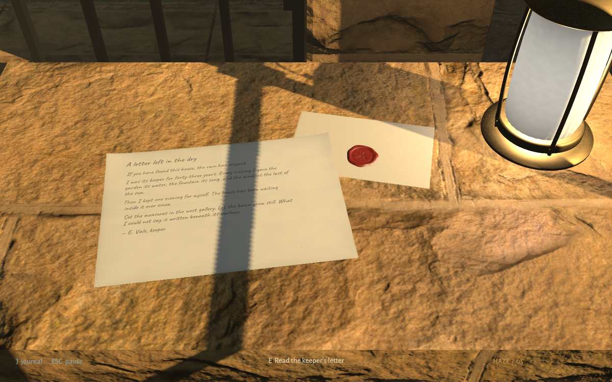

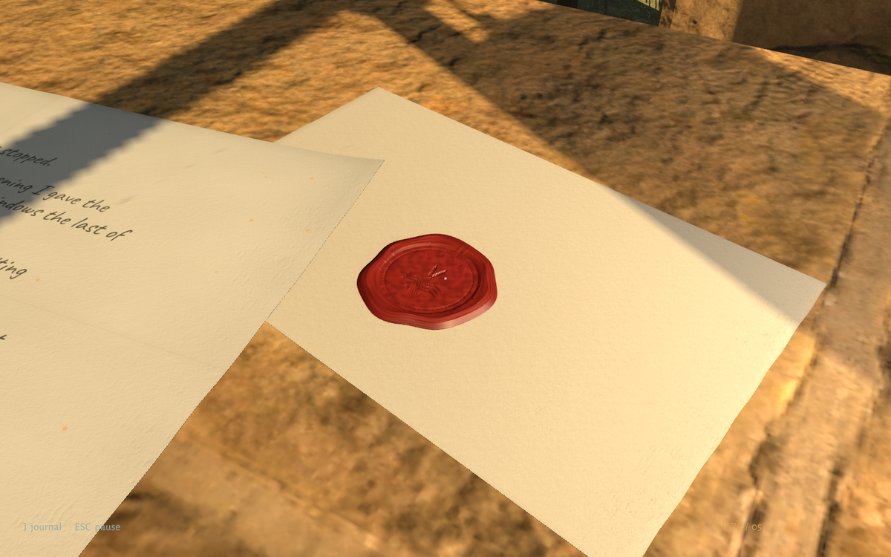

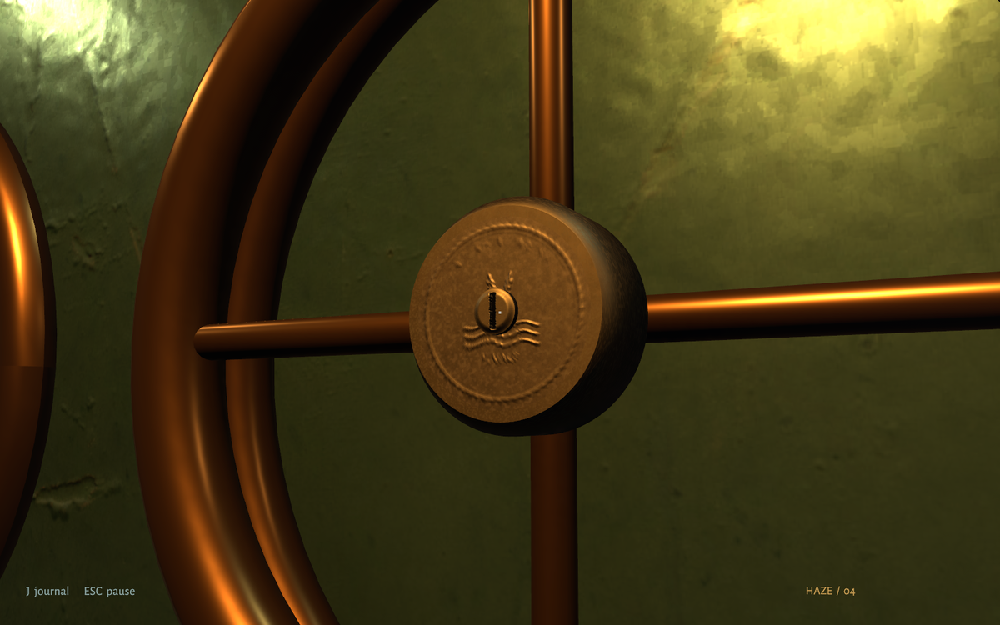

### Environment update

Entrance ironwork now sits in a continuous stone threshold and reaches a fitted arch frame. The garden fanlight has a fixed transom anchored into the stone, so opening the doors leaves it supported.

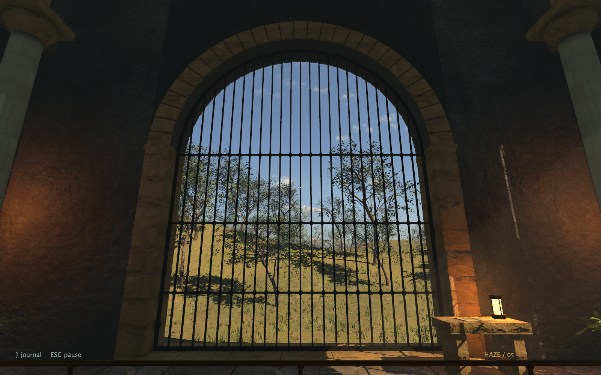

Window ironwork sits in dressed coping over continuous masonry and foundations. Coastal banks have photographed grasses, ferns, sorrel, moss, fallen leaves, and branch debris.

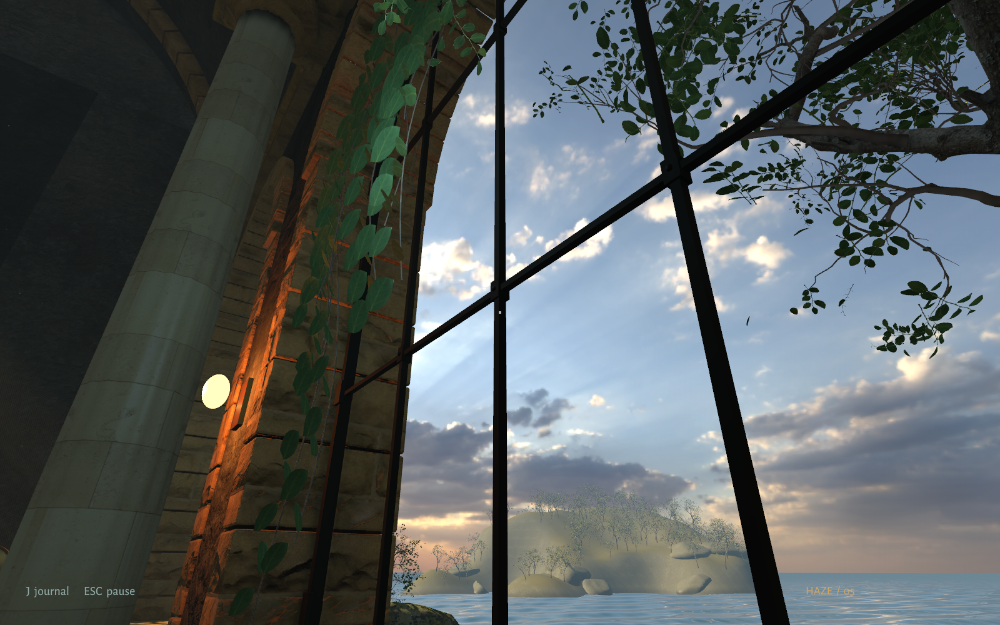
