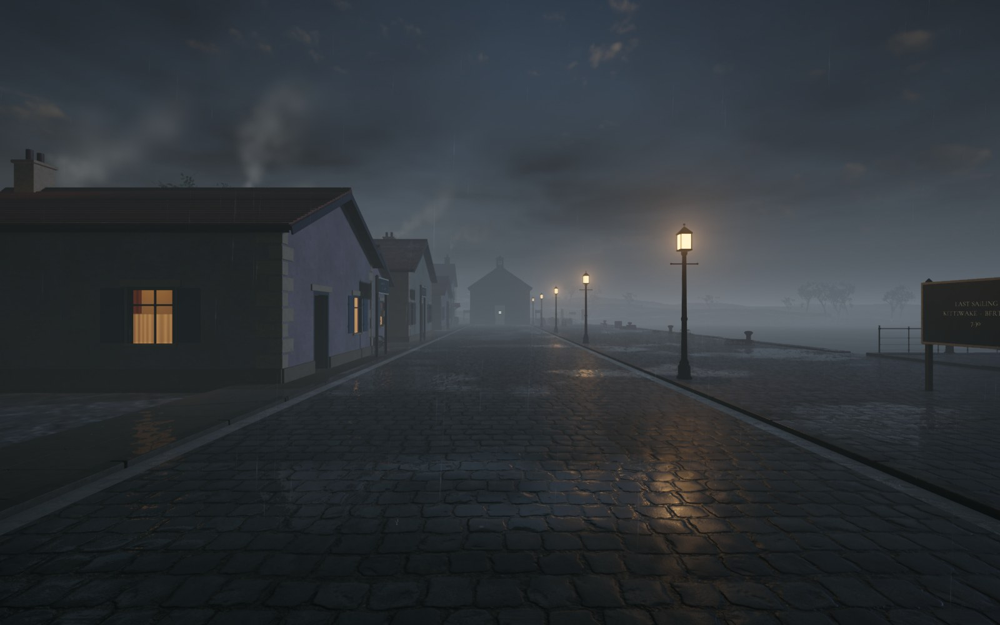
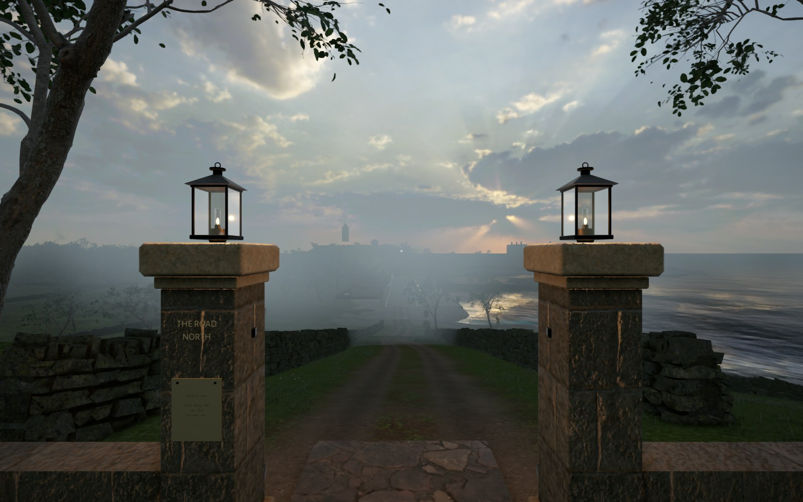
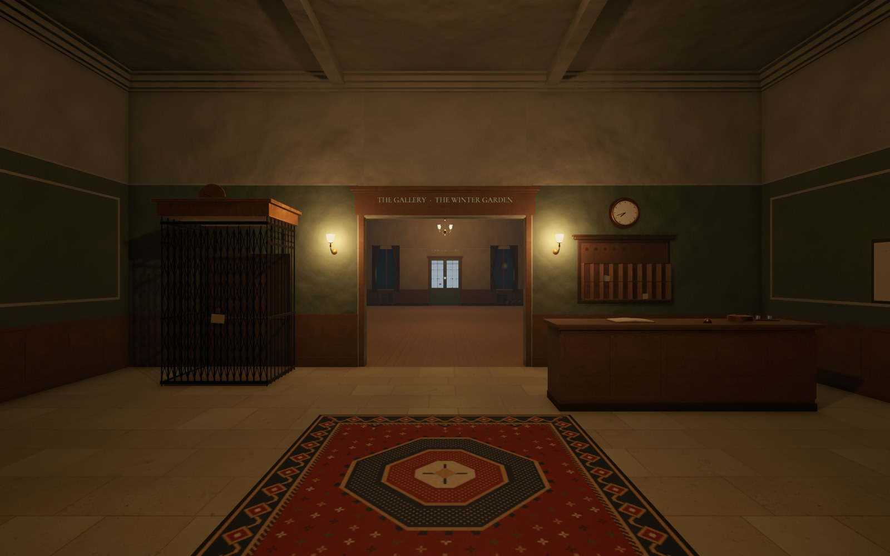
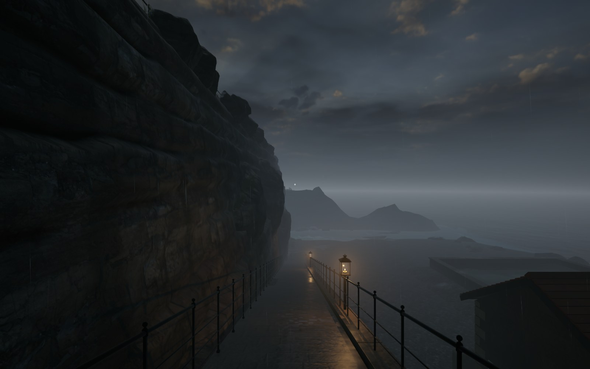
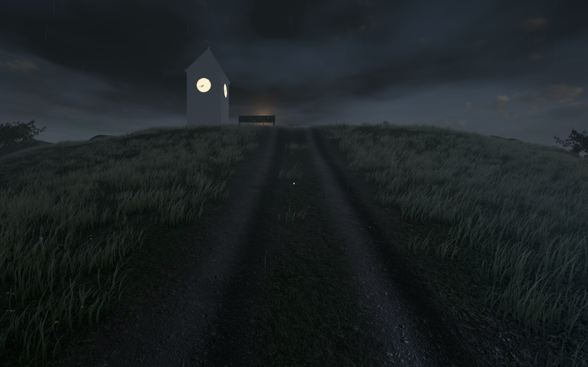
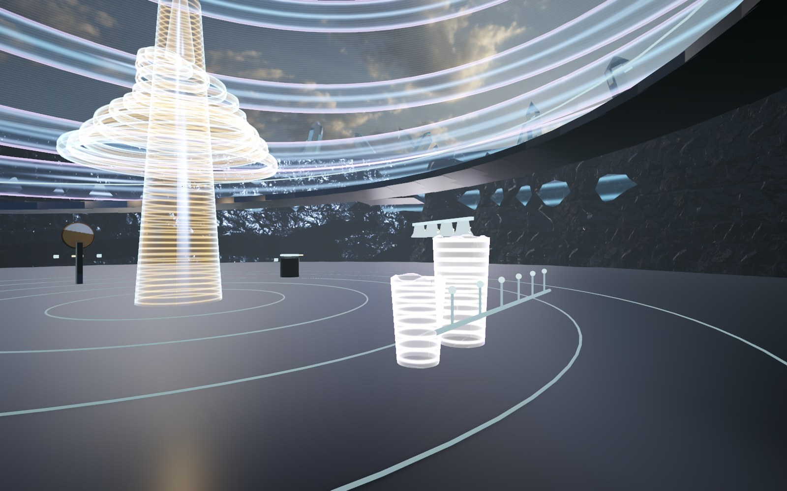
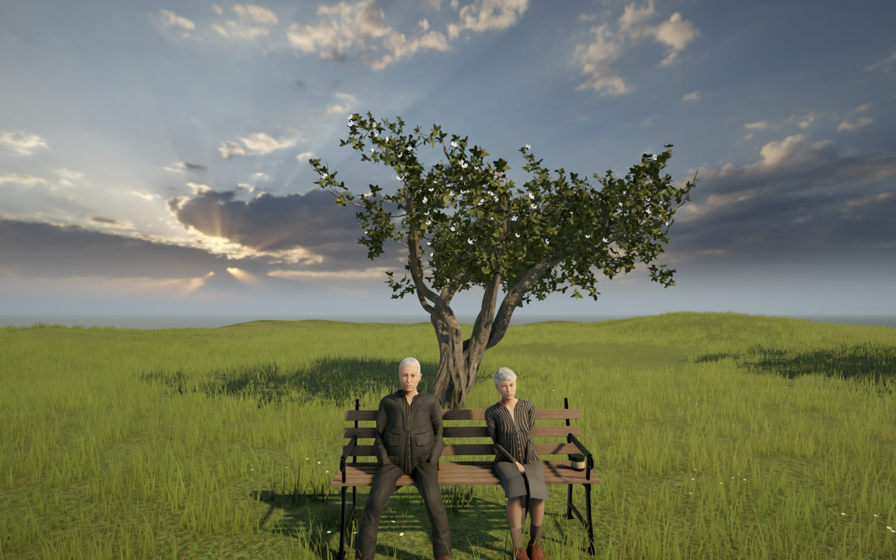
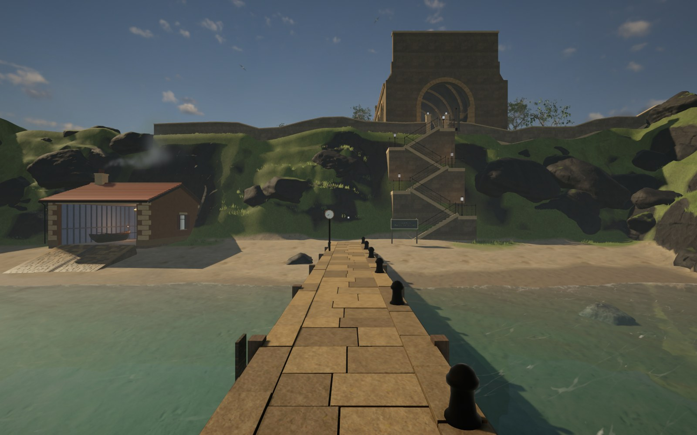

# Haze

A first-person mystery on an island lost in the haze since 1956. You row in with a bundle of returned letters for Elias Vale, keeper of the Morrow Baths. The island has kept one rainy September evening for forty-five years, and something beneath it has been keeping it for him. Walk the island region by region, finish the rounds Elias could never finish, and let each evening end. There is no combat, timer or fail state.

[Download Haze 1.0.2](https://github.com/gazhenko/haze/releases/tag/v1.0.2) · [Easy installers](#easy-installers) · [Install with your agent](#give-this-to-your-agent) · [Version history](CHANGELOG.md)



## The game

Haze is played in eight acts and an epilogue. The bathhouse is Act I; beyond its north gate lie the Village, the Springs, the West Cliffs, the Cure, the Summit and the Light, and under the northern sea, the thing the islanders called the Guest. Each region begins in rain at dusk and turns to morning when its round is done. From the Springs on, figures of light replay the last evening, voiced and subtitled. There are two endings, one of them hidden. We estimate a first visit at six to nine hours with reading.















The journal keeps the rounds of every region, a map of the island, every page you have read and three escalating hints for each puzzle. For a visit with directions, the **Guided route** setting shows the way and the exact next input, including puzzle solutions; it is off by default. Saves from earlier versions continue where they were.

## Easy installers

You do not need a coding agent, Unity, or a terminal. The installers include the whole game and work offline.

| Computer | Installer | How to install |
| --- | --- | --- |
| Mac, Apple Silicon or Intel | [Download Mac installer](https://github.com/gazhenko/haze/releases/download/v1.0.2/Haze-v1.0.2-macOS-universal.dmg) | Open the disk image, drag **Haze** onto **Applications**, then open Haze from Applications. |
| Windows 10/11, Intel/AMD 64-bit | [Download Windows installer](https://github.com/gazhenko/haze/releases/download/v1.0.2/Haze-v1.0.2-Windows-x64-Setup.exe) | Open Setup, choose **Next → Install → Finish**, then use the desktop or Start menu shortcut. No administrator password is needed. |

Each installer includes a **START HERE** guide. You can also [read the guide](https://github.com/gazhenko/haze/releases/download/v1.0.2/START-HERE.txt) before downloading. Portable archives and the Linux and Steam Deck download are on the release page.

Quit the game before updating. Updates and removal keep your saved progress. On Windows, remove the game in **Settings → Apps**; on Mac, move Haze from Applications to the Trash.

The Mac app is ad-hoc signed and has not been notarized by Apple. If blocked, try opening it from Applications, then use **System Settings → Privacy & Security → Open Anyway** for Haze ([Apple's guide](https://support.apple.com/102445)). The Windows installer is unsigned; an unfamiliar-app prompt may offer **More info → Run anyway**. Approve only the copy from the official release. The Windows installer has been packaged and its contents checked, but has not been run on a Windows PC.

## Download and play

Choose the archive for your computer under the GitHub release’s **Assets**. Extract the whole archive before launching. Keep the executable, data folder, and libraries together.

| Computer | Download | Launch | Verification |
| --- | --- | --- | --- |
| Windows, Intel/AMD 64-bit | [Windows-x64.zip](https://github.com/gazhenko/haze/releases/download/v1.0.2/Haze-v1.0.2-Windows-x64.zip) | Open `Haze.exe` | Passes its checks under Proton on Linux; not yet run on a Windows PC |
| Mac, Apple Silicon or Intel | [macOS-universal.zip](https://github.com/gazhenko/haze/releases/download/v1.0.2/Haze-v1.0.2-macOS-universal.zip) | Open `Haze.app` | Whole-island walkthrough on Apple Silicon; Intel unverified |
| Linux and Steam Deck, x64 | [Linux-x64.tar.gz](https://github.com/gazhenko/haze/releases/download/v1.0.2/Haze-v1.0.2-Linux-x64.tar.gz) | Run `./play.sh` | Whole-island walkthrough on Linux with Vulkan |

Use a keyboard and mouse, or a game controller (Xbox, PlayStation or Switch Pro, and the Steam Deck's own controls). The Mac app uses Metal. Windows defaults to Direct3D 11. Linux defaults to Vulkan. These are desktop builds; ARM Windows/Linux and mobile devices are not included.

### Give this to your agent

To have a coding agent such as Claude Code, Codex, or Cursor install Haze, paste this into it:

```text
Install Haze 1.0.2 on this computer from its official GitHub release, then tell me how to start it.

Release: https://github.com/gazhenko/haze/releases/tag/v1.0.2
Download each file from https://github.com/gazhenko/haze/releases/download/v1.0.2/<file>
  macOS, Apple Silicon or Intel  Haze-v1.0.2-macOS-universal.zip  extracts to Haze-macOS-universal/Haze.app
  Windows 10/11, x64             Haze-v1.0.2-Windows-x64.zip      extracts to Haze-Windows-x64/Haze.exe
  Linux, x64                     Haze-v1.0.2-Linux-x64.tar.gz     extracts to Haze-Linux-x64/play.sh
  Checksums                      SHA256SUMS

1. Detect the OS and CPU. If this computer is not one of the three platforms above (for example Windows or Linux on ARM), stop and tell me.
2. Check there are at least 4 GB free. Download the matching archive (about 1.6 GB) and SHA256SUMS into a temporary folder with curl -L (curl.exe on Windows).
3. Compute the archive's SHA-256 and compare it with its line in SHA256SUMS. If it does not match, delete the download and stop.
4. Extract the whole archive (ditto -x -k on macOS, tar -xzf on Linux, Expand-Archive or tar -xf on Windows). The extracted folder has its own SHA256SUMS listing every file relative to that folder; check them all (shasum -a 256 -c SHA256SUMS on macOS, sha256sum -c SHA256SUMS on Linux, Get-FileHash on Windows). If any file fails, stop and tell me.
5. Install it, replacing any earlier Haze install at the same location. Saves are stored in a separate folder, so they are kept.
   - macOS: move Haze.app to ~/Applications/Haze.app. The app is ad-hoc signed and not notarized; if it carries a com.apple.quarantine attribute, remove it with xattr -dr com.apple.quarantine on the app.
   - Windows: move the Haze-Windows-x64 folder to %LOCALAPPDATA%\Programs\Haze. Keep Haze.exe, Haze_Data and the libraries together. Add a Start menu shortcut named "Haze" that points at Haze.exe.
   - Linux: move the Haze-Linux-x64 folder to ~/Games/Haze. If the executable bits were lost, run chmod +x play.sh Haze.x86_64. Add ~/.local/share/applications/haze.desktop with Exec set to that folder's play.sh, Path set to the folder, and Icon set to its icon.png. Haze needs Vulkan drivers.
6. Delete the downloaded archive, SHA256SUMS, and anything left over from extraction.
7. Do not change system-wide security settings (Gatekeeper, SmartScreen, antivirus), and do not run anything else from the archive. Do not launch the game unless I ask. Finish by telling me where it is installed, how to start it, and that it is played with a keyboard and mouse or a game controller.
```

### First launch on Mac

Move `Haze.app` to Applications if you want to keep it there. The app has an ad-hoc signature and is not Apple-notarized. If macOS blocks it, first try opening it, then use **System Settings → Privacy & Security → Open Anyway** for Haze. Follow [Apple’s instructions](https://support.apple.com/102445) and only approve the copy obtained from this release.

### First launch on Windows

The Windows build is unsigned and has not been played on a Windows PC; it passes its own checks under Proton. Windows may show an unfamiliar-app prompt. Report launch or graphics problems with your Windows version, graphics card, and `%USERPROFILE%\AppData\LocalLow\Light Studies\Haze\Player.log`.

### Linux and Steam Deck

Extract with your archive manager or `tar -xzf Haze-*-Linux-x64.tar.gz`. Open the extracted folder in a terminal and run `./play.sh`. The archive preserves executable permissions; if your extraction tool changes them, run `chmod +x play.sh Haze.x86_64` first. On a Steam Deck, extract it in Desktop Mode, add `play.sh` to Steam as a non-Steam game, and play from Game Mode; the game picks its Steam Deck graphics preset and controller prompts by itself.

## Controls

| Keyboard and mouse | Controller | Action |
| --- | --- | --- |
| WASD / mouse | Left stick / right stick | Walk / look |
| E or left click | A / Cross | Read, ring, or turn |
| Q | X / Square | Turn a valve or mirror backwards |
| Shift | Click the left stick | Walk faster |
| J or Tab | Y / Triangle | Journal: the rounds of every region, a map, every page you have read, and optional hints |
| Escape | Menu / Options | Pause: the world waits while you change settings, save and quit, or return to a clear path |
| Escape | B / Circle | Close a page, the journal or a menu |
| Mouse wheel or arrow keys | Right stick | Read further down a long page |
| F12 | View / Share | Save a photograph |

Menus follow the d-pad or left stick. On-screen prompts follow whichever you used last.

## Settings

Look sensitivity for the mouse and the controller, inverted vertical look, volume, music, voices and mute, subtitles on or off, and the Guided route are on the pause menu. **Graphics** offers presets from Steam Deck through Low, Medium, High and Ultra to Cinematic, and every setting under them: display mode and resolution (tried for ten seconds before they are kept), frame-rate cap, field of view, brightness, text size, render scale and upscaling, anti-aliasing, shadows, ambient occlusion, water reflections, view distance, vegetation, atmosphere, rain density, bloom, motion blur, distance blur and film grain. Every voice is subtitled (the subtitles can be switched off), and the subtitles follow the text size.

## Saves and updates

Progress saves automatically, including the region you are in. Replacing the extracted game folder preserves your visit. Saves live separately under the original internal name:

- Windows: `%USERPROFILE%\AppData\LocalLow\Light Studies\The House That Remembers`
- Mac: `~/Library/Application Support/The House That Remembers` (a visit from before the Haze name, in `~/Library/Application Support/com.lightstudies.afterrain.house`, is found automatically and left unchanged)
- Linux: `~/.config/unity3d/Light Studies/The House That Remembers`

`remembered-house.json` contains progress; `.bak` is the previous save; `settings.json` contains preferences. Photographs are in `Captures`.

## Verify a download

The release includes `SHA256SUMS`. Compare your archive’s SHA-256 with its listed value:

- Windows PowerShell: `Get-FileHash .\Haze-*-Windows-x64.zip -Algorithm SHA256`
- Mac: `shasum -a 256 Haze-*-macOS-universal.zip`
- Linux: `sha256sum Haze-*-Linux-x64.tar.gz`

Each extracted package also contains checksums for its contents. See [validation results](VALIDATION.md) for the tested hardware and remaining gaps, and the [version history](CHANGELOG.md) for what each release added.

## Credits

Built with Unity and the Universal Render Pipeline. Photographed materials, the skies and source plant models come from [Poly Haven](https://polyhaven.com) under CC0, and small prop materials from [ambientCG](https://ambientcg.com), also CC0, with original ageing, glass, wax and token detail. Morrow's people are built from the CC0 [MakeHuman](https://www.makehumancommunity.org) base mesh, skins, hair and clothes, fitted, tinted for 1956 and rigged for Haze. The paintings in the Cure are public-domain works from the Open Access collection of [The Metropolitan Museum of Art](https://www.metmuseum.org/about-the-met/policies-and-documents/open-access). The type is Cormorant Garamond, Alegreya Sans and Caveat, under the SIL Open Font License.

The score, the bells, the Guest's song, the orchestrion waltz, the credits theme, rain, sea, wind, water and the stone and brass mechanisms were synthesised for Haze. The island's voices were synthesised with Kokoro (hexgrad/Kokoro-82M, Apache-2.0). Footsteps, small metal clicks and paper are adapted from Kenney’s CC0 [Impact Sounds](https://kenney.nl/assets/impact-sounds) and [RPG Audio](https://kenney.nl/assets/rpg-audio). Every source and licence is listed in the game's `Credits` folder. The architecture, story, mechanisms, interface, procedural environment and music were made for Haze.
