# Haze

A first-person mystery on an island lost in the haze since 1956. You row in with a bundle of returned letters for Elias Vale, keeper of the Morrow Baths. The island has kept one rainy evening for forty-five years, and something beneath it has been keeping it for him. Walk the island region by region, finish the rounds Elias could never finish, and let each evening end. There is no combat, timer or fail state.

[Download Haze 0.10.0](https://github.com/gazhenko/haze/releases/tag/v0.10.0) · [Easy installers](#easy-installers) · [Install with your agent](#give-this-to-your-agent)

## New in 0.10.0: sea, weather and the Steam Deck

The crossing is rowed on a real sea. A long swell rolls the boat and the bell buoys, and the wind chop on top of it is simulated on the graphics card every frame, breaking white where the waves fold. You sit in a lapstrake rowing boat with a storm lantern burning behind its glass. Morrow rises out of the haze, and the cove waits at half-flood under a strata cliff, with a dressed-stone quay, cast-iron bollards and a ladder down to the boats.

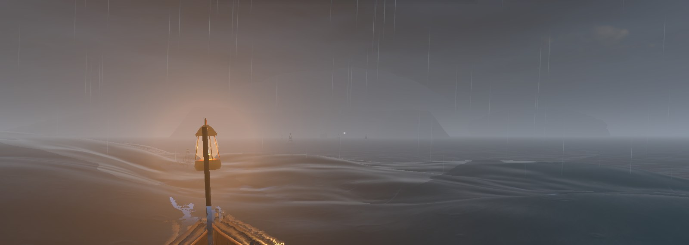

Storm cloud breaks toward evening. Sea mist lies on the water, and lamps glow in the rain. Ground, rock and grass darken in the wet but stay dry under roofs, and rain splashes where it lands. Every boulder is fractured stone with moss on its upper faces. Meadows have grass that moves in the wind. The buildings have proper pitched roofs, window and door frames, lintels and chimneys.

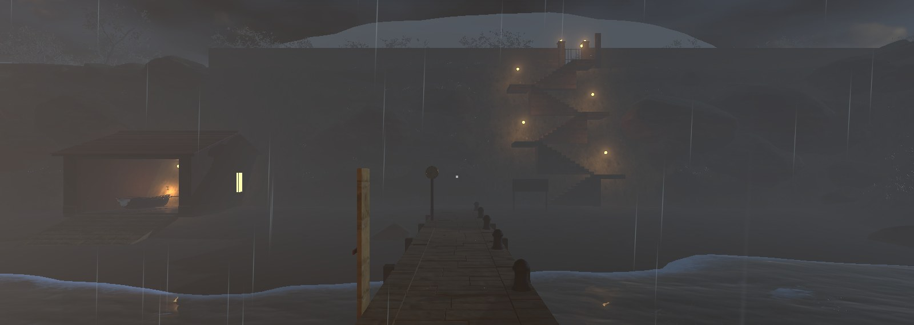

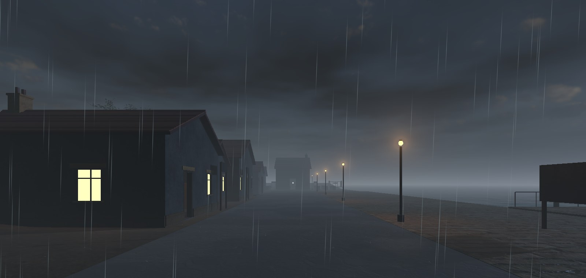

Graphics settings run from **Steam Deck** through Low, Medium, High and Ultra to **Cinematic**, or you can set any of 25 options yourself; the game picks a preset for your hardware the first time it starts. On a Steam Deck, add the Linux build's `play.sh` to Steam as a non-Steam game. The controls work in Game Mode, and with the Deck's own controller when Steam is not running.


## The island

Haze 0.10.0 is the whole game. The bathhouse is Act I; beyond its north gate lie the Village, the Springs, the West Cliffs, the Cure, the Summit and the Light, and under the northern sea, the thing the islanders called the Guest. Each region begins in rain at dusk and turns to morning when its round is done. From the Springs on, figures of light replay the last evening, voiced and subtitled. There are two endings, one of them hidden. We estimate a first visit at six to nine hours with reading.

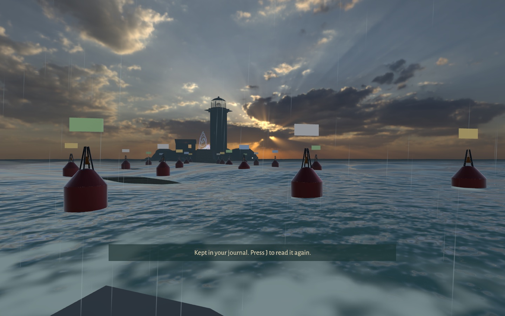

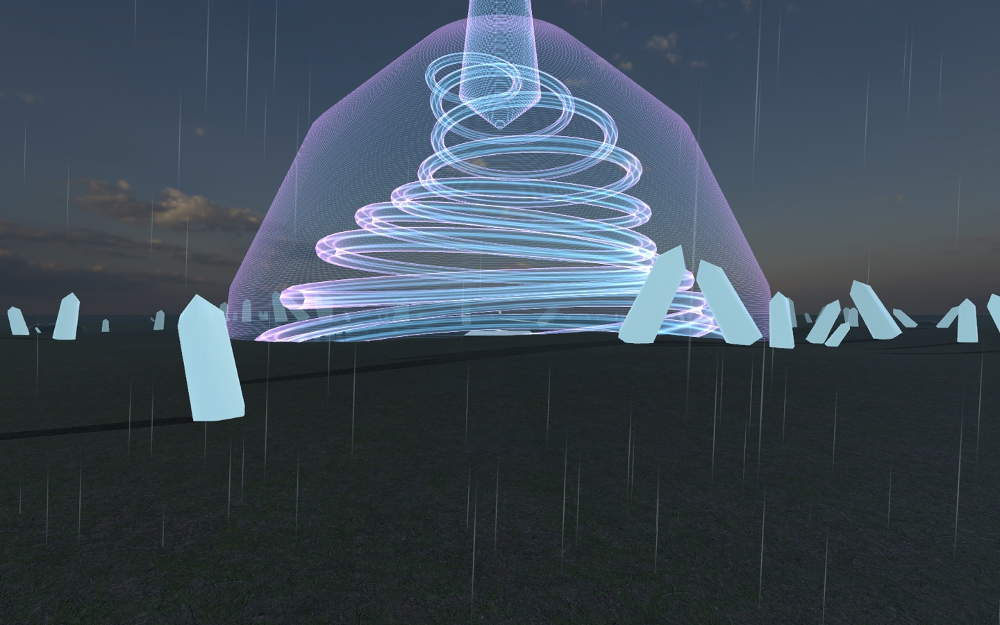

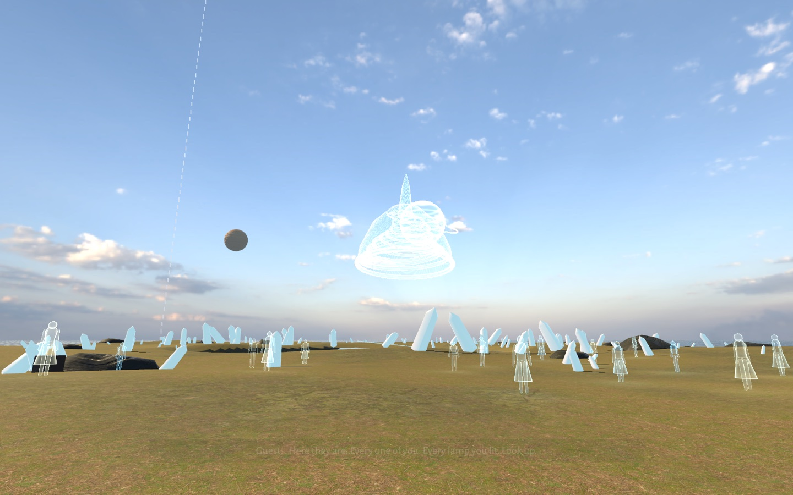

The journal keeps the rounds of every region, a map of the island, every page read and three escalating hints per puzzle. Game controllers (Xbox, PlayStation, Switch Pro) work beside keyboard and mouse. Saved bathhouse visits continue where they were.

## Trailer (the bathhouse, 0.4.0)

[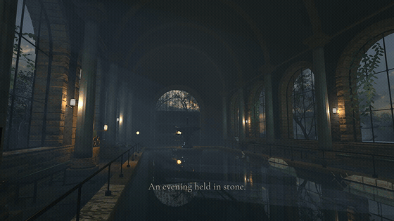](https://github.com/gazhenko/haze/releases/download/v0.4.0/Haze-v0.4.0-Trailer.mp4)

[Watch or download the full 42-second trailer](https://github.com/gazhenko/haze/releases/download/v0.4.0/Haze-v0.4.0-Trailer.mp4) · 1080p · sound on

## Story, sound and music

Haze 0.4.0 gives the house one story. The keeper’s letters, the gardener’s slate, the drowned score, the seal, the journal and the ending now agree about what happened on the evening the house still keeps, and why finishing the keeper’s rounds lets it end.

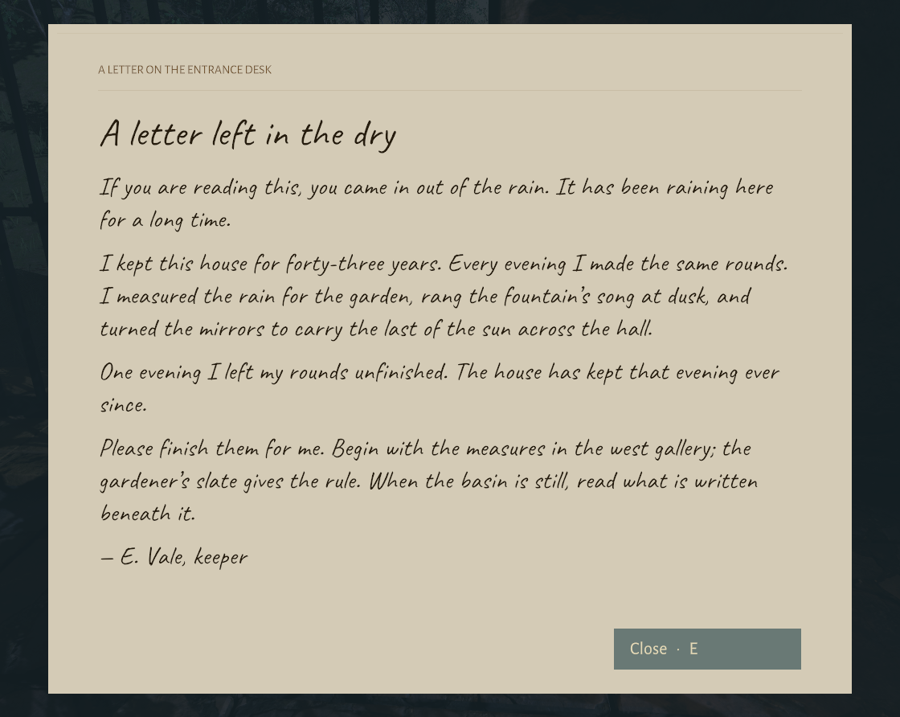

An original score for piano, harp and strings answers each finished round and steps back whenever the bells must be heard. Rain falls on the vault until the light comes home; the sea, wind, water and the brass and stone mechanisms are heard where they are. The interface is quieter: no permanent labels, act titles that appear once, pages in paper, chalk and bronze, and separate volume and music settings.

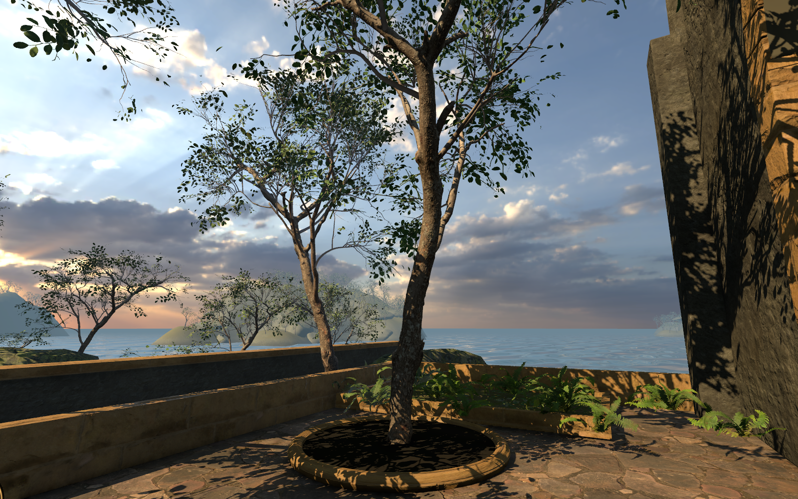

## Lamps and keeper papers

Haze 0.3.2 fitted the small lights with fluted opal glass, brass seats, curved support arms and slotted fasteners. The keeper’s letters carry their full handwritten text on thin folded paper, sealed with poured wax; in 0.4.0 the paper prints the new letters word for word.

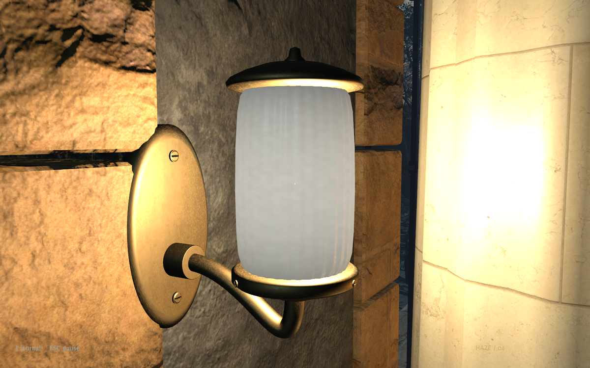

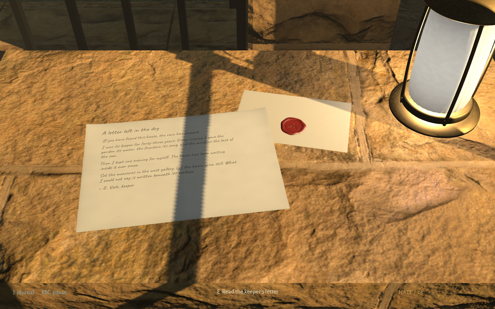

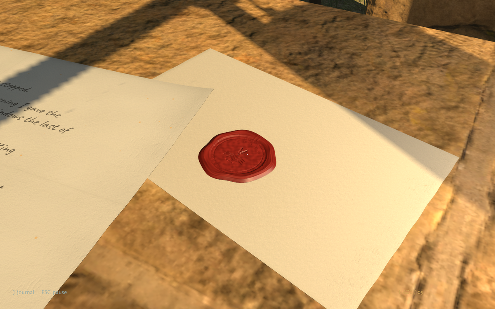

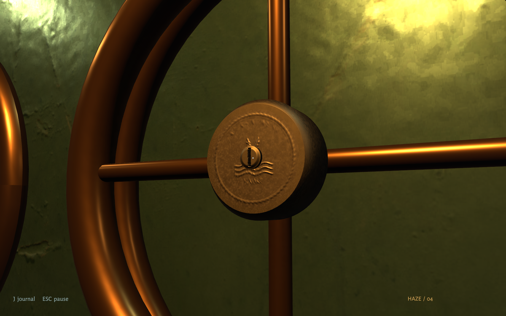

## Environment update

Entrance ironwork now sits in a continuous stone threshold and reaches a fitted arch frame. The garden fanlight has a fixed transom anchored into the stone, so opening the doors leaves it supported.

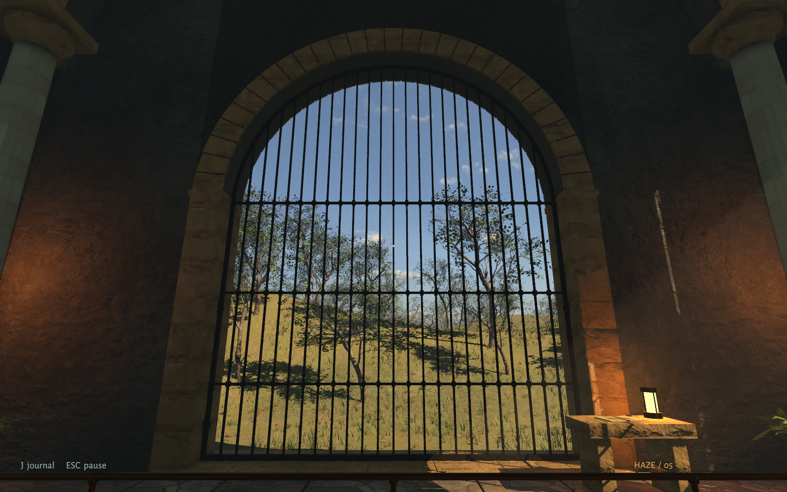

Window ironwork sits in dressed coping over continuous masonry and foundations. Coastal banks have photographed grasses, ferns, sorrel, moss, fallen leaves, and branch debris.

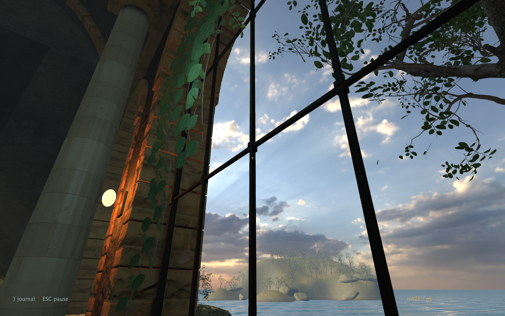

## Easy installers

You do not need a coding agent, Unity, or a terminal. The installers include the whole game and work offline.

| Computer | Installer filename | How to install |
| --- | --- | --- |
| Mac, Apple Silicon or Intel | [Download Mac installer](https://github.com/gazhenko/haze/releases/download/v0.10.0/Haze-v0.10.0-macOS-universal.dmg) | Open the disk image, drag **Haze** onto **Applications**, then open Haze from Applications. |
| Windows 10/11, Intel/AMD 64-bit | [Download Windows installer](https://github.com/gazhenko/haze/releases/download/v0.10.0/Haze-v0.10.0-Windows-x64-Setup.exe) | Open Setup, choose **Next → Install → Finish**, then use the desktop or Start menu shortcut. No administrator password is needed. |

Each installer includes a **START HERE** guide. You can also [read the guide](https://github.com/gazhenko/haze/releases/download/v0.10.0/START-HERE.txt) before downloading. Portable archives and Linux downloads are available on the release page.

Quit the game before updating. Updates and removal keep your saved progress. On Windows, remove the game in **Settings → Apps**; on Mac, move Haze from Applications to the Trash.

The Mac app is ad-hoc signed and has not been notarized by Apple. If blocked, try opening it from Applications, then use **System Settings → Privacy & Security → Open Anyway** for Haze ([Apple's guide](https://support.apple.com/102445)). The Windows installer is unsigned; an unfamiliar-app prompt may offer **More info → Run anyway**. Approve only the copy from the official release. The Windows installer has been packaged and its contents checked, but has not been run on a Windows PC.

## Download and play

Choose the archive for your computer under the GitHub release’s **Assets**. Extract the whole archive before launching. Keep the executable, data folder, and libraries together.

| Computer | Download | Launch | Verification |
| --- | --- | --- | --- |
| Windows, Intel/AMD 64-bit | [Windows-x64.zip](https://github.com/gazhenko/haze/releases/download/v0.10.0/Haze-v0.10.0-Windows-x64.zip) | Open `Haze.exe` | Built successfully; runtime unverified |
| Mac, Apple Silicon or Intel | [macOS-universal.zip](https://github.com/gazhenko/haze/releases/download/v0.10.0/Haze-v0.10.0-macOS-universal.zip) | Open `Haze.app` | Native walkthrough on Apple Silicon; Intel unverified |
| Linux and Steam Deck, x64 | [Linux-x64.tar.gz](https://github.com/gazhenko/haze/releases/download/v0.10.0/Haze-v0.10.0-Linux-x64.tar.gz) | Run `./play.sh` | Native walkthrough on Omarchy with Vulkan |

Use a keyboard and mouse, or a game controller (Xbox, PlayStation or Switch Pro). The Mac app uses Metal. Windows defaults to Direct3D 11. Linux defaults to Vulkan. These are desktop builds; ARM Windows/Linux and mobile devices are not included.

### Give this to your agent

To have a coding agent such as Claude Code, Codex, or Cursor install Haze, paste this into it:

```text
Install Haze 0.10.0 on this computer from its official GitHub release, then tell me how to start it.

Release: https://github.com/gazhenko/haze/releases/tag/v0.10.0
Download each file from https://github.com/gazhenko/haze/releases/download/v0.10.0/<file>
  macOS, Apple Silicon or Intel  Haze-v0.10.0-macOS-universal.zip  extracts to Haze-macOS-universal/Haze.app
  Windows 10/11, x64             Haze-v0.10.0-Windows-x64.zip      extracts to Haze-Windows-x64/Haze.exe
  Linux, x64                     Haze-v0.10.0-Linux-x64.tar.gz     extracts to Haze-Linux-x64/play.sh
  Checksums                      SHA256SUMS

1. Detect the OS and CPU. If this computer is not one of the three platforms above (for example Windows or Linux on ARM), stop and tell me.
2. Check there are at least 4 GB free. Download the matching archive (about 1.6 GB) and SHA256SUMS into a temporary folder with curl -L (curl.exe on Windows).
3. Compute the archive's SHA-256 and compare it with its line in SHA256SUMS. If it does not match, delete the download and stop.
4. Extract the whole archive (ditto -x -k on macOS, tar -xzf on Linux, Expand-Archive or tar -xf on Windows). The extracted folder has its own SHA256SUMS listing every file relative to that folder; check them all (shasum -a 256 -c SHA256SUMS on macOS, sha256sum -c SHA256SUMS on Linux, Get-FileHash on Windows). If any file fails, stop and tell me.
5. Install it, replacing any earlier Haze install at the same location. Saves are stored in a separate folder, so they are kept.
   - macOS: move Haze.app to ~/Applications/Haze.app. The app is ad-hoc signed and not notarized; if it carries a com.apple.quarantine attribute, remove it with xattr -dr com.apple.quarantine on the app.
   - Windows: move the Haze-Windows-x64 folder to %LOCALAPPDATA%\Programs\Haze. Keep Haze.exe, Haze_Data and the libraries together. Add a Start menu shortcut named "Haze" that points at Haze.exe.
   - Linux: move the Haze-Linux-x64 folder to ~/Games/Haze. If the executable bits were lost, run chmod +x play.sh Haze.x86_64. Add ~/.local/share/applications/haze.desktop with Exec set to that folder's play.sh, Path set to the folder, and Icon set to its icon.png. Haze needs Vulkan drivers.
6. Delete the downloaded archive, SHA256SUMS, and anything left over from extraction.
7. Do not change system-wide security settings (Gatekeeper, SmartScreen, antivirus), and do not run anything else from the archive. Do not launch the game unless I ask. Finish by telling me where it is installed, how to start it, and that it is played with a keyboard and mouse or a game controller.
```

### First launch on Mac

Move `Haze.app` to Applications if you want to keep it there. This preview has an ad-hoc signature and is not Apple-notarized. If macOS blocks it, first try opening it, then use **System Settings → Privacy & Security → Open Anyway** for Haze. Follow [Apple’s instructions](https://support.apple.com/102445) and only approve the copy obtained from this release.

### First launch on Windows

The Windows preview is unsigned and has not been played on a Windows machine yet. Windows may show an unfamiliar-app prompt. Report launch or graphics problems with your Windows version, graphics card, and `%USERPROFILE%\AppData\LocalLow\Light Studies\Haze\Player.log`.

### Linux

Extract with your archive manager or `tar -xzf Haze-*-Linux-x64.tar.gz`. Open the extracted folder in a terminal and run `./play.sh`. The archive preserves executable permissions; if your extraction tool changes them, run `chmod +x play.sh Haze.x86_64` first.

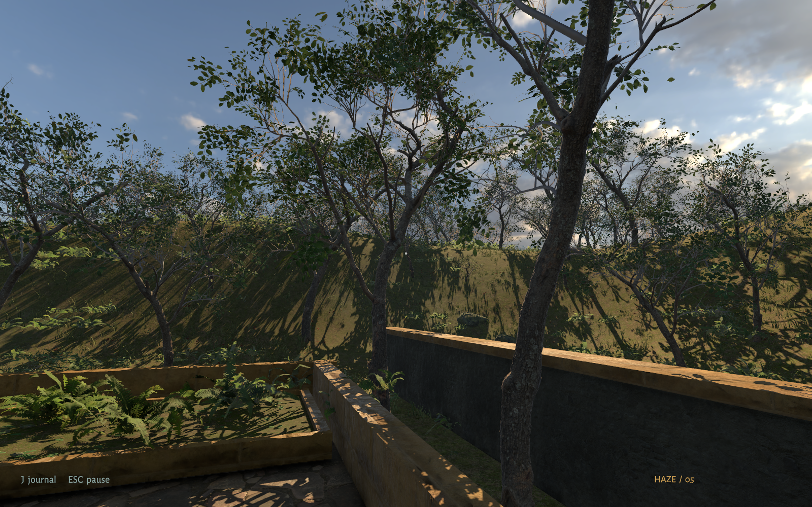

## Controls

| Control | Action |
| --- | --- |
| WASD / mouse | Walk / look |
| E or left click | Read, ring, or turn |
| Q | Turn a valve or mirror backwards |
| Shift | Walk faster |
| J or Tab | Journal: the rounds of every region, a map, the pages you have read, and optional hints |
| Escape | Pause: volume, music, mute, look sensitivity, developer guide, save and quit, or return to a clear path |
| F12 | Save a photograph |

For a guided visit, press **Escape → Developer guide: ON**. It gives directions and exact puzzle inputs. It is off by default.

## Saves and updates

Progress saves automatically, including the region you are in. Replacing the extracted game folder preserves your visit. Saves live separately under the original internal name:

- Windows: `%USERPROFILE%\AppData\LocalLow\Light Studies\The House That Remembers`
- Mac: `~/Library/Application Support/The House That Remembers` (a visit from before the Haze name, in `~/Library/Application Support/com.lightstudies.afterrain.house`, is found automatically and left unchanged)
- Linux: `~/.config/unity3d/Light Studies/The House That Remembers`

`remembered-house.json` contains progress; `.bak` is the previous save; `settings.json` contains preferences, including volume and music. Photographs are in `Captures`.

## Verify a download

The release includes `SHA256SUMS`. Compare your archive’s SHA-256 with its listed value:

- Windows PowerShell: `Get-FileHash .\Haze-*-Windows-x64.zip -Algorithm SHA256`
- Mac: `shasum -a 256 Haze-*-macOS-universal.zip`
- Linux: `sha256sum Haze-*-Linux-x64.tar.gz`

Each extracted package also contains checksums for its contents. See [validation results](VALIDATION.md) for the tested hardware and remaining gaps.

## Credits

Built with Unity and the Universal Render Pipeline. Photographed materials, the sky, and source botanical models come from Poly Haven under CC0. Small prop materials also use CC0 assets from [ambientCG](https://ambientcg.com), with original aging, glass, wax, and token detail. The letter handwriting uses Caveat under the SIL Open Font License.

The score, the bells, the Guest's song, the orchestrion waltz, the credits theme, rain, sea, wind, water and the stone and brass mechanisms were synthesized for Haze. The island's voices were synthesized with Kokoro (hexgrad/Kokoro-82M, Apache-2.0). Footsteps, small metal clicks and paper are adapted from Kenney’s CC0 [Impact Sounds](https://kenney.nl/assets/impact-sounds) and [RPG Audio](https://kenney.nl/assets/rpg-audio). Every sound’s origin and licence is listed in `Credits/audio-sources.json`; source links, font licences and the Kenney licence texts are in `Credits`. The architecture, story, mechanisms, interface, procedural environment additions and music were made for Haze.
